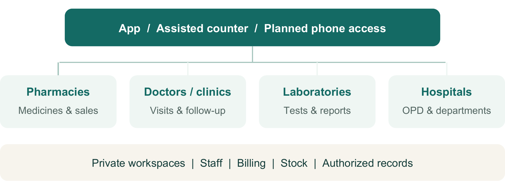
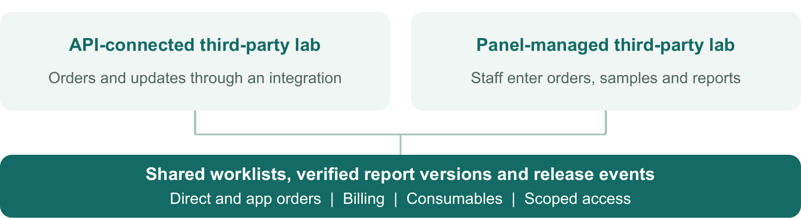

# SwasthaDisha - Operations & Services Prospectus

Healthcare without Boundaries

**Pre-launch | 9 November 2026 | Prospectus v1.0**

## 1. Healthcare that connects. Operations that work.

A connected platform for patients, pharmacies, doctors, laboratories, hospitals and service partners.

Designed for everyday care in smaller cities, with a brand and operating model built to grow.

*Internal operations prospectus | Pre-launch | Product scope, not a launch-availability promise*

## 2. One network. Two ways to use it.

SwasthaDisha is planned as both a patient-facing healthcare network and the daily operating workspace for healthcare businesses. A partner can use its private workspace without listing services publicly.

### Patient-facing services

Discover participating providers, book consultations and tests, order medicines, track requests and access authorized care documents. App, counter-assisted and planned phone routes connect to the same care journey.

### Private business operations

Manage direct customers, walk-ins, appointments, sales, service bills, stock, purchases, staff and reports. Publish only the eligible services the business chooses; private patients, tariffs and records remain scoped to authorized staff.

### Partners keep their own business identity

Support independent partners and platform-operated facilities, multiple branches and enabled departments. Software subscription charges, marketplace commissions and the business's own sales remain distinguishable; final commercial plans are still to be decided.

*Reading guide: patient access 3; pharmacy 4; retail/wholesale 5; doctors 6; labs 7; hospitals 8; vendors 9; stock 10; finance 11; phone access 12; daily operations 13; care/support 14; phases 15; extensions 16; readiness 17.*

## 3. More ways to reach care.

A smartphone should be one route into care. Assisted registration and direct business visits are also part of the product; the basic-phone consultation channel is separately planned.

### Find, book and receive care

- Discover approved doctors, pharmacies, labs and hospital services by availability and service area.
- Book a consultation or test, place a medicine order, choose applicable pickup/delivery and follow status updates.
- See disclosed charges and payment status; receive an authorized receipt and track a cancellation or refund request.

### A connected patient record

- A permanent platform patient reference, with business-local references and authorized family/dependent relationships.
- Consultation history, prescriptions, released reports, referrals and follow-up tasks linked to the relevant visit.
- Consent and access controls for record sharing. A shared phone number does not merge patients or expose another person's history.

### Assisted and inclusive access

- Register a walk-in without requiring a patient app account or public profile; support printed references and receipts.
- Use approved caregiver or reception assistance for patients without their own phone.
- Offer the separately gated phone service without requiring a smartphone, SMS capability or ABHA.

> Illustrative journey: identify the patient, confirm the service and price, book, receive care, collect authorized outcomes and arrange follow-up. Clinical access is granted by authority and consent, not by who paid or referred.

*Initial rollout builds these journeys in stages. Language coverage, opening hours, delivery coverage and response commitments require operational decisions before publication.*

## 4. Pharmacy sales, across channels.

A pharmacy workspace covering online orders and connected in-house sales, with one accountable stock balance for the branch. Planned delivery: M3, on the shared M0-M2 foundations.

### Serve customers

- Search medicines, build an app cart or counter bill, identify the right customer and apply the permitted retail or wholesale tariff.
- Upload and review prescriptions, record authorized pharmacist approval/rejection and gate dispensing where review is required.
- Prepare pickup/delivery orders and track packing, readiness, handover and service exceptions.

### Control medicine stock

- Track medicine batches, units, expiry and stock locations; allocate eligible stock using earliest-expiry rules.
- Reserve, release and dispense stock; manage low-stock, expiry, recall and quarantine worklists.
- Receive purchases, count stock and record authorized adjustments with reasons. Returned medicines remain held until the approved quality/restock decision.

### Run the business

- Issue invoices, receipts and linked return/credit records; reconcile cash and digital collections at shift close.
- Maintain supplier purchases and returns, margin/stock views and refill preferences with planned reminder delivery.
- Support staff and branch roles so counter activity does not automatically grant clinical, price-master or financial override authority.

> Daily example: receive a supplier batch, sell through the counter and app, preserve the same stock history, resolve a return and close the cashier's day.

*Counter sales initially require internet. Disconnected selling and later synchronization are M7 scope. Existing pharmacy APIs are foundations, not proof that the complete workspace is ready.*

## 5. The right price for the right buyer.

Retail and wholesale sales are planned through both the app and connected counters. Buyer eligibility, price class, origin channel and payment method remain separate facts.

### Pricing and selling

- Retail/wholesale price lists, effective dates and verified buyer eligibility, with approved quantity slabs or minimum orders where selected.
- Pack, strip and unit conversion with clear sale/stock units; server-calculated totals, discounts and configured tax/rounding treatment.
- Controlled counter price overrides, approval limits and reason history; preserve the price accepted for each sale.

### Buying and receiving

- Supplier records, purchase orders, goods receipt, supplier invoices and purchase returns.
- Check delivered quantities, batch/expiry and quality status; reconcile shortages and mismatches.
- Maintain supplier payables and customer outstanding balances with traceable receipts and credits.

### Credit is a controlled extension

Wholesale credit requires approved customer limits, terms, aging and collections workflows. Until those controls are accepted, the operating default is prepaid/settled payment. A pending payment label does not create a credit facility.

> An online payment does not turn a direct walk-in sale into a marketplace order. Keep origin, referral, price entitlement and commission attribution accurate.

*Pricing, invoice entities, taxes, discounts and credit terms need finance/pharmacy approval before activation. No rates, commissions or credit limits are set by this prospectus.*

## 6. One workday. One doctor workspace.

A doctor and reception workspace for bookings, clinical work, collections and follow-up. Planned clinic delivery: M2; supplies and purchasing extend through M3.

### Manage availability and the queue

- Profiles, services, fees, working hours, slots, holidays and rescheduling rules.
- App appointments, receptionist bookings and walk-ins using shared practitioner capacity; planned phone consultations join the same capacity model.
- Arrival, queue and visit status with cancellation/no-show handling and clear patient communication.

### Complete the clinical visit

- Authorized history, encounter notes, diagnosis, advice, requested tests and prescriptions.
- Clinical sign-off, original/corrected document versions, report-review inbox and acknowledged critical-result escalation.
- Referrals and follow-up tasks, with appropriate caregiver authority and clinical assessment of remote versus in-person suitability.

### Collect and reconcile

- Consultation/procedure bills, receipts, cash/online collections, pending dues and day-close views.
- Separate direct-clinic income from marketplace earnings, statements and settlement status.
- Receive and consume clinic supplies against visits/procedures, record waste and monitor low stock. Medication dispensing uses the pharmacy workflow when enabled.

> Daily example: add a walk-in, avoid a slot clash with an app booking, complete the visit, collect the fee, issue a receipt and arrange follow-up.

*A recorded payout is distinguishable from a confirmed bank transfer. Audio consultation does not guarantee a prescription; clinical suitability and prescribing policy remain clinician-controlled.*

## 7. Third-party labs, with or without APIs.

The lab workspace covers platform orders and the lab's own direct, walk-in and referred customers. Both delivery routes are in scope for M4, including billing and basic consumables inventory.

### Manage orders and samples

- Private/public test tariffs, assigned worklists, collection appointments and sample status.
- Collection, receipt, rejection/recollection and overdue-test tracking within the lab and branch's authority.
- Direct test bills, receipts, pending dues and reagent/kit/vial usage, waste and stock worklists.

### Release trustworthy reports

- Upload or retrieve reports; distinguish preliminary, final and corrected versions, preserving the original.
- Authorized signatory verification/release, clinician-review tasks and critical-result communication/acknowledgment.
- Release notifications and configured outgoing webhooks, with delivery history, failed-delivery worklists and controlled replay.

> No lab API is required for the panel route. Staff use the panel for orders, sample updates and report release. Switching an order between routes must be explicit to prevent duplicates.

*A full LIS is optional later scope. Basic reagent and consumable management is included in daily operations; analyzer connectivity, QC and calibration are separate extensions.*

## 8. Hospital OPD and billing first.

The initial hospital workspace focuses on reception, OPD coordination, service billing and department stores. Hospital delivery is planned in M5 after the common and clinical foundations.

### Reception and outpatient care

- Patient registration, hospital/branch references, departments and individual staff roles.
- OPD appointments, walk-ins, queue management, doctor assignment and visit status.
- Consultation/procedure documentation, clinical referrals and authorized outcome/discharge records where applicable.

### Billing and department coordination

- Approved department tariffs, invoices, receipts, refunds, pending dues and cashier close.
- Coordinate lab requests and pharmacy fulfilment without exposing unrelated patient records.
- Keep hospital-owned departments and independent third-party providers under their correct ownership and settlement arrangements.

### Stores and supplies

- Central and department stores, purchase/receive, issue/receive transfers and in-transit reconciliation.
- Service/procedure supply consumption, wastage, lot/expiry where applicable and stock counts.
- Preserve medicine-specific dispensing and quality rules for an enabled hospital pharmacy.

> Daily example: register an OPD patient, route the visit, bill the services, issue department supplies and reconcile the cashier and stores at close.

*IPD admissions, beds/wards, nursing, OT and advanced insurance/claims workflows are later scope. This prospectus does not present the first hospital release as a complete enterprise HMS.*

## 9. A workspace for each partner team.

Verified service partners get controlled self-service for the work assigned to them and their enabled private business modules. The lab-specific panel arrives in M4; broader vendor self-service expands in M5.

### Set up the business

- Business profile, branches, eligible service types, verification documents and renewal worklists.
- Individual staff invitations, roles, branch/service access and access removal when staff leave.
- Private service catalogue and tariff proposals, with separately approved public listing and publication controls.

### Run assigned services

- Availability, serviceability, capacity, holidays and assigned order worklists.
- Accept/reject with reasons, fulfilment updates, required documents and customer-service exceptions.
- API integrations or panel operation as appropriate; scoped integration access and webhook settings where enabled.

### Manage commercial follow-through

- Statements, collections/dues visibility, approved marketplace attribution and settlement tracking.
- Disputes, corrections and support cases with accountable owners and supporting evidence.
- Enabled internal sales/services, inventory and software-plan views without requiring every partner to use every module.

> Partner access follows the business, branch and assigned service. A vendor account does not grant unrestricted patient history, platform-wide catalogue editing or access to another business's finances.

*Disabling a public listing stops new discovery under policy; accepted work, refunds and authorized records still need completion. Final subscription packages and partner contracts remain commercial decisions.*

## 10. Direct business, connected operations.

Here, 'offline' means a direct counter or walk-in transaction with internet. Daily business workflows are not limited to orders generated by the SwasthaDisha app.

| Business | Stock and operating use |
| --- | --- |
| Pharmacy | Medicine batches, expiry, reservations, dispensing, sales and approved returns. |
| Laboratory | Reagents, kits, vials and consumables used against a test or sample workflow. |
| Doctor / clinic | Supplies used in visits/procedures, with stock counts, waste and low-stock views. |
| Hospital | Central/department stores, transfers, service consumption and purchasing. |

### One accountable stock history

Receive, reserve, sell/consume, transfer, return, count and reverse with the right actor and reason. A repeated order/report update must not consume supplies twice. Quantity changes do not clear a quality hold, and a service's included supplies are not automatically billed again.

*If an external ERP owns a stock balance, the integration respects that authority. Internet-outage capture, device limits and conflict synchronization remain M7.*

## 11. Make every collection explainable.

The product separates what was billed, what was collected, what remains due and what was actually refunded. Business books and platform commercial charges have distinct views.

### Customer and supplier records

- Service/product invoices, receipts, linked credits and authorized refunds.
- Cash, gateway and approved balance payments with clear pending/confirmed/reconciled states.
- Customer dues, supplier payables, approved wholesale credit controls and period/shift close.

### Partner and platform records

- Direct-business revenue separately attributed from marketplace orders and commissions.
- Business software-plan invoices separately identified from medicine-refill subscriptions.
- Partner/doctor statements, settlement obligations, disputes and actual disbursal confirmation.

### Exception handling

- Payment captured but order confirmation pending: hold for reconciliation rather than asking for an uncontrolled second payment.
- Cancellation, credit note and refund: track each outcome and its owner without duplicating a return of funds.
- Cash mismatch, missing settlement or uncertain provider outcome: retain evidence and assign a resolution task.

> A business collecting cash does not prove that money reached the platform. A wallet credit does not prove an original-payment-method refund. A released report does not prove the bill was paid.

*Finance approves invoice entities, tax treatment, opening balances, funding arrangements, refund policies, commission and settlement rules. Full general-ledger accounting and insurance/claims automation are not implied.*

## 12. Doctor access by basic phone.

A separately planned channel lets approved pharmacy, lab or hospital counters assist a patient with a funded healthcare account and a doctor helpline. This is not a mobile-network airtime recharge.

### The intended journey

- Identify the patient/caregiver, confirm the beneficiary and funding, and provide a printed or SMS receipt/reference.
- Complete approved contact verification and private PIN setup; shared numbers require distinct patient selection and authority.
- Call the helpline, choose a supported language, hear the fee and use available doctor capacity or an approved queue/callback.
- Reserve funds and capacity; waiting/no-answer does not consume the consultation fee. Reconnection uses the same consultation, with one evidenced charge.
- Receive authorized outcomes by the suitable channel. A partner that tops up an account does not automatically receive clinical documents.

> No app, smartphone, SMS capability or ABHA is required. Urgent-help/referral routing must remain available without waiting for a balance top-up. A prescription is subject to clinical suitability and policy.

*F14 follows accepted M1/M2 foundations with a separate estimate. Funding model, clinical rules, phone provider, language/hours, fees and recovery need approval; an M4 pilot is conditional, not committed.*

## 13. From onboarding to day-close.

Operations turns the product into a dependable service: verify the partner, train the right staff, keep work moving and resolve exceptions with an accountable owner.

### Onboard and prepare

- Verify the business, branches and required documents; enable selected modules and approved public services.
- Invite individual staff and assign reception, clinical, pharmacy, lab, cashier, inventory and administrative responsibilities.
- Import service/item masters, authorized patient references, opening stock and balances through reviewed templates; reconcile before activation.
- Agree hours, service area, tariffs, escalation contacts and training. Rehearse a direct and an app-origin journey.

### Operate the day

- Before opening: review staff availability, doctor capacity, stock restrictions, pending confirmations and overdue reports.
- During service: work the appointment/order/sample queues; route critical results and urgent clinical needs to the named clinical team.
- Resolve payment uncertainty, failed deliveries, recollection, cancellations and document corrections through the appropriate worklist.
- At close: reconcile receipts, cash, stock movements, supplies usage, dues, refunds and unresolved handover tasks.

### Measure and support

The planned operations console brings together partner verification/publication, service queues, refund/support exceptions and failed-delivery worklists. Dashboards cover backlog, turnaround, fulfilment, low/restricted stock, collections, dues and settlement exceptions. Agree targets during the pilot; this prospectus does not invent service-level commitments.

*Reception/cashier permissions do not confer clinical editing or PIN-reset authority. Access, export, staff removal, backup/restore and continuity drills belong in the operating playbooks.*

## 14. Care that continues after booking.

The operating model includes follow-up, local coordination and support. A completed booking or delivered reminder alone does not prove that care was completed.

### Follow-up and clinical handover

- Assign care tasks with a due date, responsible team, missed-contact escalation and recorded outcome. Keep refill reminders separate from free-follow-up benefits.
- Track clinical referrals, receiving-facility acceptance, outcome and authorized discharge linkage. Record urgent incidents and communications for the responsible clinical team.

### Communication and patient support

- Use consented SMS, email, push and approved local-language templates, including Odia where selected. Record delivery failures/retries and minimize clinical detail on shared channels.
- Provide a complaint reference, category, assigned owner, escalation and closure evidence. Clinical incidents and ordinary service complaints have appropriate responsible teams.

### Local operations and reporting

Support approved field/coordinator roles and village, Panchayat, block and district views for adoption, pending care and partner quality. Establish a first-30-day baseline before setting reviewed business targets; restrict patient-level reporting and export to authorized purposes.

### Printable and exportable registers

Planned registers cover registration, consent, history, consultation requests/encounters, prescriptions, diagnostic bookings/reports, follow-up, referrals, incidents, onboarding, payments, complaints and audit. Each view follows its record owner and access permissions.

*Detailed registration, clinical, diagnostics, privacy, emergency-escalation, support and reporting SOPs are required by the corresponding service launch. These workflows extend the product scope; they do not certify an emergency-response service.*

## 15. A staged path to launch.

Use milestones to understand delivery order. Calendar dates and final scope commitments follow foundation acceptance, staffing and detailed contracts; these are not promised launch dates.

| Stage | Planned operational outcome |
| --- | --- |
| M0 / foundations | Reproducible build/start/test, access containment, payment recovery and safe record preservation. |
| M1 / common setup | Business/branch/staff, private/public settings, patient/consent and common billing/item contracts. |
| M2 / doctors | Clinic appointments, clinical work, fees, direct/app attribution and billing foundations. |
| M3 / pharmacy & stock | Connected POS, pharmacy workflows, purchasing, supplies, returns and cashier close. |
| M4 / laboratories | API and panel routes, direct lab work, sample/report release, billing and consumables; gated pilot. |
| M5 / hospitals & vendors | Hospital OPD/stores, broader vendor workspaces, software-plan records and reporting. |
| M6 / rollout | Cross-service validation, imports/restore, measured capacity, training and staged expansion. |
| M7-M8 / extensions | Disconnected sync, deeper HMS or full LIS after dedicated scope and specialist review. |

### Separately scheduled

F14 phone access needs its own estimate after M1/M2 and funding/clinical/telecom gates. Optional ABHA/ABDM needs a separately scheduled integration track. Neither is silently included in M0 or guaranteed by an M4 pilot.

> The initial engineering target is 100 useful aggregate HTTP requests per second across released workflows. It is unmeasured and does not mean 100 simultaneous doctor calls; phone capacity has separate trials and operating limits.

## 16. Keep the expansion path clear.

The architecture preserves room for these capabilities. They require their own delivery scope, approvals and acceptance; the operations team should not sell them as available.

### Optional health-network integration

Later ABHA linking and consent-driven ABDM record exchange, with standards mapping, sandbox validation and production onboarding. ABHA remains optional for patient registration and basic-phone care; ordinary uploaded reports do not establish ABDM integration.

### Deeper business systems

M7 adds bounded disconnected capture and synchronization after the connected product is stable. M8 evaluates IPD, beds/wards, nursing and OT, or laboratory analyzer/QC/calibration workflows. Insurance/claims, full general-ledger accounting and advanced asset maintenance remain separate selected scope.

### Decisions operations must help close

- Pilot locations, branches, enabled services, languages, hours and staffing.
- Pickup/delivery coverage, collection routes, turnaround expectations and escalation ownership.
- Pricing, software packages, marketplace attribution, settlement/refund terms and wholesale credit eligibility.
- Phone funding model, disclosed call charges, callback/queue rules and private verification support.
- Clinical sign-off, critical-result contacts, training, grievance handling and support handovers.
- Opening-data quality, authorized exports, record continuity and recovery exercises.

*These are planning choices and operational gates, not hidden features assumed complete. Owners should resolve the applicable choices before each affected service is activated.*

## 17. The vision and today's baseline.

SwasthaDisha is pre-launch. Technical reviewers approved bounded M0 implementation start; pilot and production acceptance require delivered and tested workflows.

### Useful foundations already identified

Identified backend foundations include pharmacy catalogue/cart/orders, batches, low-stock queries, counter-sale records, doctor portal APIs, prescription PDFs, payment/payout flows and third-party lab integrations. Reuse still needs hardening, interface completion and execution evidence.

### Major product work still planned

Cross-business workspaces, common billing, supplies/procurement, complete POS/returns/day-close, safe shared capacity, the lab panel, hospital OPD, broader vendor self-service and phone access remain partly or wholly to be delivered.

### What the review evidence means

The 70-capability source check records 19 Existing, 18 Partial, 30 Missing and 3 Unverified: bounded backend findings, not completion percentages. The 115-case register has 0 PASS, 1 FAIL, 1 BLOCKED, 110 NOT_RUN and 3 DEFERRED. It is not an exhaustive guarantee against defects.

### Release and communication rule

Publish availability only after the relevant UI, workflows, access, reconciliation, training and domain checks pass. Give partners an accurate enabled-module list and identify later scope.

### Planning sources

- `documentation/planning/BUSINESS_OPERATIONS.md; ROADMAP.md`
- `documentation/planning/CAPABILITY_MATRIX.md; PHONE_CONSULTATIONS.md`
- `documentation/planning/SYSTEM_DESIGN.md; M0_START_APPROVAL_STATUS.md`
- `documentation/planning/qa/EXECUTION_REGISTER.csv`

*Planning v1.7 and owner clarifications through 9 November 2026. AI-generated illustrations depict concepts, not screenshots, real facilities or testimonials. The typographic wordmark is not a final-logo approval.*

