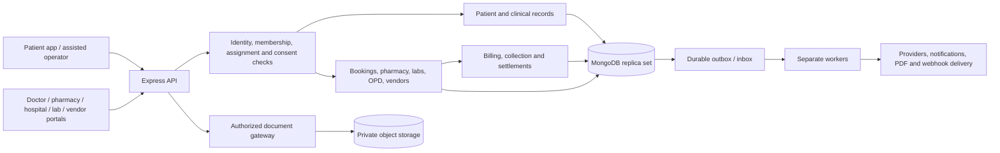

# Jansetu requirements and delivery roadmap

**Status:** proposal for review, 8 November 2026. **Code baseline:** `pharmyx-fixes` at `9ca8b54606581f2158e760cad79aa7b845529184`. Existing code observations are static, not proof of production behavior. See [repository evidence](REPOSITORY_REVIEW.md), [performance acceptance](PERFORMANCE_PLAN.md) and [open source research](OPEN_SOURCE_OPTIONS.md).

**Second source cross-check:** the [capability matrix](CAPABILITY_MATRIX.md) separates existing APIs from partial and missing workflows. Low-stock queries, connected counter orders/manual payment marking, basic prescription medicine fields, in-person assisted booking and specialist payout records already exist. Preserve these; the delivery scope below includes hardening and interface completion as well as new work. Refill preferences exist, but no due-refill dispatcher was identified.

**Expanded product direction:** every pharmacy, lab, doctor/clinic and hospital can use Jansetu for its own in-house sales/services, billing, purchases and inventory, including business received outside the app. Marketplace participation is optional; private records and direct business remain available through the management workspace. The [business operations specification](BUSINESS_OPERATIONS.md) defines this scope, stock/finance boundaries and acceptance. M0 duration is now re-estimate at kickoff; later planning windows are anchored to its accepted completion (T0), superseding earlier project-start calendar ranges.

**Open source review:** 35 projects were screened against this scope. Trial small packages/panel frameworks first (CASL, Refine Core or react-admin; conditional BullMQ; external k6), and assess ERPNext/Marley, InvenTree or OpenELIS through separately scoped adapters only where justified. Current-source license/edition exclusions and a full trial sequence are in the [reuse comparison](OPEN_SOURCE_OPTIONS.md). No code was imported and no timeline saving or 100 RPS result is assumed from reuse.

**Architecture review v1.7:** [AR-01–AR-36 disposition](ARCHITECTURE_REVIEW.md) corrects money/wallet evidence, tenant repositories, preliminary/immutable reports, real v1 routes and recovery gates. Existing-flow payment recovery and report preservation move into M0 (F11/F12); create-only correctness indexes/readiness are F13. AR-14–AR-18 add atomic customer wallets, resume-before-retry, independent M0 recovery gates, opening balances before M2 and case-free reviewer inputs. AR-19 adds a single guarded source-payment refund budget across wallet/gateway/cash destinations; M1 is explicitly provisional and the M0 mobile confirmation change has a named owner. AR-20–AR-22 add transient/keyed PIN handling, explicit funding choices/qualified pharmacy sponsorship reuse, audio prescribing and available-versus-held guards. F14 still follows M1/M2 with no new M0 dependency. AR-23/AR-24 restore the full F14 journey and acceptance scope, private first-use PIN/bounded recovery, staged abuse continuity and explicit follow-up evidence. AR-25 adds independent patient/contact binding and masked-number/reuse checks; possession alone cannot enable credentials or protected admission. Decision rows retain PIN transport/key and prescribing mode/type with named key-lifecycle approval. AR-26–AR-36 add command/catalogue authority, quality/resource identity, restore admission/local-effect recovery, embedded-history bounds, lot price/quote rules, earlier finance contract decisions, provider/benefit recovery and precise QA gates. See the [two-review disposition](PRINCIPAL_REVIEW_DISPOSITION.md) and [M0 approval packet](M0_IMPLEMENTATION_APPROVAL.md). These are planning changes, not implemented fixes.

**Architecture package:** [SYSTEM_DESIGN.md](SYSTEM_DESIGN.md) specifies the proposed module/data boundaries, tenant/patient access, transaction and payment races, API/panel lab flows, event delivery, deployment and cutover. Use the [review prompt](ARCHITECTURE_REVIEW_PROMPT.md) to challenge it against source and this roadmap before implementation. Its performance profile references the existing performance plan; v1.7 retains post-M0 windows as provisional estimates and adds separately estimated F14 phone access; v1.2 replaced fixed project-start windows with the post-M0 schedule below.

## 1. Product contract and evidence

Build a coordinated healthcare platform around one patient identity and a continuous care record, with daily business-management workspaces for pharmacies, labs, clinics/doctors, hospitals and service vendors. Support direct/in-house and marketplace business through the same trusted organization, clinical, billing and stock boundaries. Reuse this backend's functioning foundations and introduce missing workflows incrementally.

Sources, in order of purpose:

1. **User request:** six service areas, online/counter retail and wholesale, payments, 100 RPS, repository review, open source reuse assessment and a written roadmap before implementation.
2. **User clarification:** connected counter sales first; disconnected operation/sync later. Hospital OPD and billing first; IPD/advanced workflows later. Third-party labs with APIs use integrations; third-party labs without APIs receive a Jansetu lab partner panel.
   **Later scope direction:** all business types need their own in-house sale/service and inventory management. Support private operations with optional public listing, both Jansetu-operated and partner businesses, and direct customer channels. Subscription/commission commercial rates remain proposed, not agreed.
3. **Product input:** `Jansetu_Master_SOP_V1.docx`, document `JS-SOP-001`, version 1.0, issued 4 November 2026, explicitly a proposed SOP. Its workflow requirements inform this plan; its illustrative priorities/timeline do not prove current capabilities or override the user's scope.
4. **Implementation evidence:** current source, route wiring, schemas and tests. Existing README/issue files are useful history and are reconciled against current code.
5. **External evidence:** primary-source project/license and standards references linked below and in the research file.

SOP input path: `/Users/shubham/Downloads/Jansetu_Master_SOP_V1.docx`. SHA-256: `dc876da03d481017d94430356bde728ba6225f0bea683ffee89b97b21bd6d286`. Content was extracted for requirements; the source document was not modified or committed. Document instructions were treated as source material, not authority to run commands, contact people or deploy software.

**Priority:** P0 = required before the relevant workflow handles live patients or money; P1 = staged expansion after that workflow's safe initial release; P2 = later optimization. A module cannot defer its own safety controls to a later phase. Payments move earlier than SOP section 19 because the user explicitly included them.

## 2. Six workstreams and acceptance

All six workstreams use the shared business foundation: individual staff, business/branch scope, private service/item masters, direct versus marketplace attribution, invoice/receipt/credit records, purchases and stock where applicable. Internal customers do not need an app login or public profile. A non-medicine supplies inventory module extends pharmacy foundations to lab/clinic/hospital supplies without removing medicine-specific safety rules. See [BUSINESS_OPERATIONS.md](BUSINESS_OPERATIONS.md).

### U1. Pharmacy: app ordering and in-house sales

**Reuse:** `pharmacies`, `pharmacyMedicines`, `pharmacyInventory`, `pharmacyInventoryImports`, `pharmacyCart`, `pharmacyOrders`, `pharmacyCustomers`, `pharmacySubscriptions`, `pharmacyWallet` and existing payments. The code already represents batches, FEFO allocation, reservations, expiry/quarantine/recall states, paise totals, HSN/GST snapshots, pickup/delivery and assisted customer creation.

**Deliver:** pharmacy/staff verification and branch permissions; searchable catalogue; prescription upload and authorized pharmacist review; reserve → dispense/consume or release; app cart and connected POS; printed receipt/invoice; delivery/pickup tracking; shift cash reconciliation; stock adjustments with reasons; returns into quarantine or approved restock; expiry/recall worklists; automated low-stock communication and purchasing handoff, reusing the existing low-stock query. Prescription attachment alone must not authorize dispensing: implement review, rejection reason, reviewer identity and a fulfilment gate. Do not adopt the existing guide's proposed AI approval as a substitute for authorized review.

**Acceptance:** two concurrent buyers competing for the last batch quantity cannot oversell; expired/recalled/quarantined stock is blocked; a rejected prescription blocks dispensing; cancellation releases the exact reservation; fulfilment consumes it once; a partial return creates linked stock and financial reversals without rewriting the original sale. The POS operator can close a shift and explain the difference between expected and counted cash.

### U2. Retail and wholesale through app and counter

Keep **sales channel** (`app`, `counter`) separate from **buyer class** (`retail`, `wholesale`). Current `orderType: online|in_store` describes the channel; `buyerPharmacyId` selects wholesale pricing. Add origin channels for phone, approved import/API and direct operations through compatibility mapping, with referring party and commission attribution recorded separately. An online payment does not automatically make a direct sale a marketplace order. Add explicit entitlement/pricing policy without breaking existing fields.

**Deliver:** retail/wholesale price lists and effective dates; verified buyer eligibility; pack/strip/unit conversion and stock unit; quantity slabs/minimum quantities if commercially required; controlled discounts/price overrides; tax/rounding snapshots; buyer and supplier accounts; purchase order → goods received note → supplier invoice; purchase returns; sale returns/credit notes; receivables/payables, credit limits and aging where wholesale credit is enabled. Until credit is implemented, require settled payment rather than silently treating an unpaid order as credit.

Use the same stock authority for app and POS. Model fulfilment, invoice, collection and settlement separately. Define whether prices include tax, which entity issues the invoice, invoice numbering by legal entity/financial period, and who funds discounts. Finance review must confirm applicable GST/e-invoicing/e-waybill requirements; this plan does not prescribe rates or thresholds.

**Acceptance:** all four channel/buyer combinations select the server-authorized price; a retail caller cannot obtain wholesale entitlement by changing a request field; unit conversion preserves stock; approved override records actor/reason; invoice totals reconcile to receipts, refunds and outstanding balances. Connected POS can recover from a request timeout without duplicating a sale.

### U3. Hospital management: OPD first

**Reuse:** patients/account mappings, specialists, slots/bookings, file/report access, payments and clinical records. Existing `partners` CRUD and a specialist's `hospitalOrClinic` string are not a hospital operations system.

**First release:** hospital organization/branches/departments, staff memberships, patient lookup and facility MRN mapping, OPD registration, appointment/walk-in token queue, triage/vitals, clinician encounter, investigations, prescriptions, service tariff, invoice, cash/online receipt, cancellation/refund, referral acceptance and discharge-document capture. An external hospital's discharge summary may be uploaded before native inpatient operations exist.

**In-house business scope:** private OPD services and receipts work without a marketplace listing. Add central/department supply stores, purchases/receipts, issue/receive transfers, visit/procedure consumption, stock counts, authorized waste/adjustments and cashier close. A medicine-dispensing department retains pharmacy rules. Basic hospital supplies are initial scope; they do not wait for IPD.

**Later releases:** admission/discharge/transfer and bed census; nursing observations and medication administration; ward billing/deposits; OT scheduling/consumables; insurance/TPA/claims if required; blood bank, radiology/PACS and biomedical inventory as separately scoped integrations. Do not put the whole list into the OPD pilot estimate.

**Acceptance:** an unlisted hospital can complete a private OPD visit and receipt; app and walk-in visits link to the right patient/business. Department receipts, issues/consumption/transfers and counts reconcile; users see only authorized records; charges, receipt and documents reconcile; cancellations use auditable reversals. Later IPD acceptance must prove bed transfer/census consistency and discharge reconciliation.

### U4. Lab partner services: API integrations and panel

**Confirmed operating model:** diagnostic fulfilment includes third-party lab vendors. Support two routes according to each lab/branch's capabilities. A lab without its own APIs receives a Jansetu panel; it does not need to build an API before joining.

**Daily lab business:** the same workspace manages the lab's own walk-in, phone and referred customers, private test tariffs, invoices/receipts, purchases and reagent/kit/vial/consumable stock. An app account or marketplace listing is not required. Basic stock receipt, lot/expiry where applicable, consumption, waste, count/adjustment and low-stock worklists are initial scope. Origin and API/panel fulfilment mode are separate fields; prevent duplicate orders and dual stock writers when a lab also uses an external system.

| Lab partner model | How orders and reports are managed | Existing foundation / delivery |
| --- | --- | --- |
| API-connected third-party labs | Send orders through the provider adapter; receive status/reports through authenticated callbacks, or reconcile by polling when the provider contract requires it | Reuse LabStack/Healthians and existing external booking/catalogue/payment/report services. Add other provider adapters only against a verified contract. |
| Panel-managed third-party labs | Lab staff log in to Jansetu, manage assigned orders/sample status, upload reports and release them using permitted roles | Build the missing lab partner panel and its organization/branch/assignment permissions. The panel calls Jansetu's backend; no API operated by the lab is required. |

**One common lab-order workflow:** preserve one patient/encounter link and canonical order reference, mapping existing external booking/provider IDs when applicable. Record the assigned lab/branch and `fulfillmentMode: api` or `panel` on the order. Both routes use the same permitted statuses, commercial policy, report versions, audit and doctor-review workflow. Changing fulfilment mode after dispatch requires an explicit, audited handover; never create a second provider order or payment silently when an API times out. API events and panel edits must not compete as independent writers for the same order.

**API route:** catalogue/serviceability/slots → order submission → provider reference → status callbacks or reconciliation → secure report ingestion → release/review. An optional status view for API partners does not grant permission to overwrite provider-owned status. Provider outages surface to operations with retry/reconciliation state.

**Panel first release:**

1. Lab organization/branch onboarding, verified credentials/signatory and individual staff accounts. Lab admin, order/sample staff and report signatory have distinct permissions; a lab sees only its assigned orders and necessary patient details.
2. Configure private test menus/packages, tariffs, collection options, hours and turnaround commitments through authorized lab staff. Marketplace publication/pricing follows the agreed operations approval; neither private nor public changes alter a booked price.
3. Create direct/walk-in/referral test orders and manage Jansetu assignments in source-aware worklists: new, accepted, sample-pending, processing, report-pending and completed. Staff accept/reject with reasons and coordinate appointment/collection details; record invoice, receipt, balance and refund separately.
4. Record lab-local reference, sample collection/receipt times, rejection/recollection and processing status. Use the lab's existing barcode/reference where available; a new barcode/analyzer system is not a prerequisite for this panel.
5. Upload the original PDF/image against an assigned order; validate patient/order linkage, scan/quarantine the upload, record report date/signatory and preserve source. Authorized verification/release is separate from upload. Structured result entry is optional unless the agreed lab workflow requires it.
6. After release, update the shared timeline and create the clinician-review task and authorized patient/doctor notifications. A corrected report is a new linked version with a reason; original files remain preserved.
7. Manage supply purchasing/receipt, explicit or approved per-test consumption, waste and balances using the supplies inventory boundary. Consumption is linked to its order/procedure and cannot be posted twice by report release, callback replay or repeated clicks.
8. Show delivery failures, overdue reports and critical-result acknowledgments. Keep direct-business receipts/dues distinguishable from marketplace commissions and settlements, and extend detailed statements as the commercial scope completes.

**Events and webhooks:** both provider report ingestion and panel report release publish the same durable `lab.report.released` or amended-report event. These events drive patient/doctor notifications, care tasks and optional signed webhooks to subscribed systems. A panel-managed lab does not need an inbound webhook endpoint or external API to complete an order. Incoming provider events still require authentication, durable inbox/deduplication and ordering; outgoing deliveries need retry, attempt history, dead-letter handling and replay. Persist before acknowledging receipt. Validate report URL destinations/redirects and minimize clinical data in event payloads.

**Safety:** clinician-approved critical-result escalation with named owner, direct communication, acknowledgment deadline and backup contact applies to both routes. Delivery of a push notification is not completed clinical escalation. Clinical reviewers set thresholds and communication rules.

**Optional full LIS:** lack of a partner API does not require deploying a complete LIS. Basic reagent/consumable stock is now included in daily business scope. Analyzer connectivity, QC, calibration, instrument-generated consumption and accreditation workflows remain a separate lab-led decision in M8. Evaluate OpenELIS only if that deeper scope is required; verify its actual API/event extension points instead of assuming native webhooks exist.

**Acceptance:** complete an API-connected lab journey and a panel-managed journey, plus a direct cash-paying patient at an unlisted lab without app login. Test lab isolation, signatory release, recollection, amendments/review, critical acknowledgment and stock usage/waste reconciliation. Callback/click replay cannot duplicate booking, payment, report, consumption or refund. Failed outgoing delivery remains replayable; the panel route does not call a lab-owned API.

### U5. Doctor workspace, app/walk-in bookings and payments

**Reuse:** specialist self-service APIs, availability/slots, booking lifecycle, prescriptions, one-level follow-up benefit, Google Meet, reminders and specialist payout calculations. This checkout supplies APIs and curl documentation, not a finished dashboard.

Already implemented medicine fields are name, dosage, frequency, duration and instructions, plus diagnosis/advice/tests and prescription PDF generation. In-person consultation mode, pharmacy-assisted booking, and admin payout/disbursal/invoice/receipt APIs also exist. Additional work covers explicit strength/route, finalization/amendments, receptionist queue, doctor finance visibility and safe integration; these existing foundations are not greenfield tasks.

**Deliver:** verified-credential activation; staff/delegation permissions; daily/monthly schedule, leave/blocked time and walk-in queue; booking accept/reassign/reschedule/cancel/no-show; shared capacity across app and counter; patient history subject to care assignment and consent; dated vitals/history/assessment/diagnosis; prescription strength, dose, route, frequency, duration and advice; signed/finalized encounter and amendments; test orders, report-review inbox and follow-up tasks. Preserve the existing free-follow-up policy until product decides a change; care follow-up reminders are independent of a free consultation benefit.

**Clinic operations:** support private appointments/walk-ins, procedure tariffs, invoices/receipts, cashier close and clinic supply purchases/usage even when public booking is disabled. Link consumables to a visit/procedure, record wastage and reversals, and test source attribution. Supply management does not by itself enable medicine dispensing; that uses the pharmacy workflow when applicable.

**Money:** fee/tariff snapshot, cash/UPI/gateway collection evidence, receipt, refund state, doctor earnings vs collected amount, adjustments and settlement statement. Add authenticated gateway-event recovery and scheduled gateway-to-ledger reconciliation so a closed app or missing client verification callback cannot strand an actual payment. A payout calculation or generated invoice does not prove a bank transfer occurred.

**Acceptance:** app and walk-in booking races cannot exceed capacity; payment timeout cannot leave an unexplained wallet debit or occupied slot; only the assigned clinician can finalize/amend a note; a second prescription version preserves the first; report review produces a recorded outcome; collections and clinician payable reconcile separately.

### Basic-phone access across U1–U6

Add [partner-assisted top-ups and phone consultations](PHONE_CONSULTATIONS.md): an authorized pharmacy/lab/hospital identifies the patient, takes a funded account top-up and issues a receipt; the patient calls Jansetu from a basic phone, verifies identity, accepts a disclosed fee and connects to an available doctor. Reuse patient, consent, capacity, billing and clinical operations. Shared phone numbers need distinct patient selection and spending authority; a smartphone, SMS capability and ABHA are not prerequisites. Top-up rights do not grant chart access.

Use approved prefunded/confirmed funding, one consultation reservation and an evidenced fixed-fee charge; waiting/no-answer does not consume the consultation fee and a dropped call reconnects without automatic recharging. Voice-provider events are authenticated/reconciled but do not establish clinical completion. Refunds share the original source budget across destinations. F14 requires P1 selection of Partner-paid consultation, Consultation-only balance or General patient wallet before sizing, plus finance/legal/clinical/telecom decisions and a separate estimate after M1/M2; a limited M4 pilot is conditional on resources and acceptance. Do not absorb this feature into M0 or promise the existing delivery windows unchanged.

### U6. Third-party vendor service workspace

**Reuse:** partner profile/catalogue concepts and provider adapters; pharmacy/specialist scoped APIs are useful patterns. `partners` currently has no general vendor staff/assignment/settlement model.

Labs are one vendor type. U4 is the lab-specific workspace within the shared partner/organization access model, not a second identity or isolated vendor system. The minimum staff/assignment/report panel for labs ships in M4; the broader vendor catalogue, statements and dispute experience expands in M5.

Every business can enable its internal modules before choosing marketplace participation. Include private catalogue/tariffs, direct order entry, own business invoices and stock, publication controls and SaaS plan records. Software subscription billing is distinct from recurring-medicine subscriptions. Keep private operations and marketplace finance distinguishable; commercial rates remain to be decided.

**Deliver:** vendor organization, branches, verified service types and documents; staff invitations, roles and revocation; service/product catalogue and price proposals; capacity/serviceability and holidays; assigned orders; accept/reject/fulfil and evidence; report upload where authorized; disputes/support; collection/commission/refund/settlement statements; payout references; webhook subscriptions and delivery logs. Third-party API clients need scoped, revocable credentials and per-client limits. Vendor types must have different permissions and forms.

**Acceptance:** vendor A cannot list, guess, export or mutate vendor B's orders/files; staff departure revokes access; catalogue changes cannot alter an already sold price; a vendor can complete its assigned service and reconcile its statement; no non-clinical vendor obtains the patient's full health record. Validate the first vendor types before creating a generic workflow engine.

## 3. SOP traceability and missing requirements

“Partial” below means related code exists; acceptance still needs validation. “Missing” means no dedicated implementation was identified in this checkout's module/schema inventory and inspected paths. Each row maps to the phase that must complete it, including controls that recur throughout delivery.

| Requirement / SOP section | Baseline and required work | Delivery / priority |
| --- | --- | --- |
| S01 scope and S24 patient/rural principles | Backend has accounts/bookings; connect the whole care journey and support assisted/local-language access | All phases / P0 |
| S02 patient registration | User/dependent/pharmacy-customer models exist; add permanent patient ID, age precision/source, village/Panchayat/block/district, no-phone route, caregiver and reviewed duplicate merge | M1 / P0 |
| S03 consent | No dedicated consent ledger found; versioned purpose/language/method/actor/time, withdrawal and caregiver authorization must affect access and future sends | M1 / P0 |
| S04 EHR | Booking prescriptions/reports and specialist-local history exist; add encounters, observations, allergies/source, conditions, medications, documents and amendment history | M1–M2 / P0 |
| S05 journey | Booking lifecycle exists; add episode-linked tasks, owner, deadlines and incomplete-care worklists across modules | M2–M4 / P0 |
| S06 doctor onboarding/consultation | Credentials/verification fields and portal exist; enforce activation and care assignment; add complete encounter and physical-review outcomes | M0–M2 / P0 |
| S07 prescription/medication | Name/dosage/frequency/duration/instructions, diagnosis/advice/tests and PDF generation exist; add explicit strength/route, authentication/finalization/version history and dispensing linkage | M2–M3 / P0 |
| S08 diagnostics | External lab APIs exist; add direct/app orders, private lab billing/supply stock and no-API partner panel with shared report/signatory/review. Both routes require critical escalation | M3–M4 / P0 |
| S09 follow-up | Booking reminders, one-level benefit and pharmacy refill preference/date fields exist; no due-refill dispatcher identified. Add refill dispatch and clinician-defined care tasks, missed-contact escalation and outcomes | M3–M4 / P0 for enabled reminders |
| S10 hospital referrals/emergencies | Existing `referral` is an acquisition-reward module; build clinical referral/acceptance/discharge and emergency incident/escalation separately | M4–M5 / P0 before service launch |
| S11 chemist operating routine | Pharmacy roles/linked customers exist; build permitted assisted registration, consent, request coordination and daily handover/reconciliation screens | M1–M3 / P0 |
| S12 roles/access | User/admin/HR/specialist/pharmacy roles exist; add organization/branch/assignment/purpose checks, individual staff accounts, operations/field/lab/hospital/support scopes | M0–M5 / P0 |
| S13 communication | SMS/email/push and reminders exist; add preferences, Odia/local-language templates, authorized voice-assisted workflow, delivery/retry and minimum clinical data | M1–M4 / P0 |
| S14 money | Gateway/wallet/payout logic exists; add cash control, invoice/receipt, partial refunds, reconciliation and provider settlement statements | M2–M5 / P0 for money flows |
| S15 security/backups/audit | Logger and some transaction ledgers exist; remove public PHI and keys, fix auth, add purpose/access audit, retention/hold, encrypted storage and tested restore | M0 onward / P0 |
| S16 grievances | No dedicated case-management module found; complaint ID, assignment, category, escalation, response and closure evidence | M4 / P0 |
| S17 operations/reporting | Admin/pharmacy summaries exist; add pending-care/doctor-review, clinical incidents, village/Panchayat adoption and partner quality views | M4–M5 / P0 baseline; deeper analytics P1 |
| S18 forms/registers | Some underlying records exist; create the explicit mappings below and printable/exportable views with permission checks | M1–M5 / P0 for released workflow |
| S19 priorities | Use launch gates per workflow; user brings payments forward; ABDM readiness P1, AI analytics P2 | M0–M6 |
| S20 KPIs | Instrument definitions/events; establish first-30-day baseline, then set business targets with clinical review | M4–M6 / P0 instrumentation |
| S21 timeline | SOP's 30/60/90 days is illustrative and narrower than requested commerce/HMS scope | Conditional roadmap below |
| S22 readiness | Patient ID/merge, assisted access, consent, timeline, verification, audit/export, backup and complaint checklist become release gates | M0–M6 / P0 |
| S23 regulatory/standards | Track India/state, data protection, telemedicine, pharmacy/lab requirements and ABDM applicability; qualified owners approve current obligations | M0 onward / P0 for applicable controls |
| S25 supporting SOPs | Product/operations owners write registration, EHR, teleconsult, diagnostics, follow-up, emergency, onboarding, privacy, support and reporting runbooks | By corresponding module release / P0 |
| S26 simulation/sign-off | Execute 10–20 synthetic journeys, including no-phone, repeat, elderly, chronic, diagnostic and emergency cases; document exceptions and sign-offs | M4 pilot and M6 rollout / P0 |

### Required register mapping (S18)

| SOP register | Proposed authoritative record |
| --- | --- |
| JS-01 registration | Patient + registration provenance + account mapping |
| JS-02 consent | Consent event/version and representative authority |
| JS-03 medical history | Clinical history, source and verification state |
| JS-04 consultation request | Booking/request linked to patient and episode |
| JS-05 consultation | Encounter with clinician-authenticated finalization/amendments |
| JS-06 prescription | Versioned prescription and fulfilment linkage |
| JS-07 diagnostic booking | Lab order and external ID mappings |
| JS-08 diagnostic report | Verified report versions, original document and review task |
| JS-09 follow-up | Care task, due date, responsible team and outcome |
| JS-10 hospital referral | Clinical referral, acceptance, outcome and discharge linkage |
| JS-11 emergency | Incident with timestamps, communications, responsible clinician and outcome |
| JS-12 partner onboarding | Organization/credential verification history and staff memberships |
| JS-13 payment | Collection/refund ledger, invoice/receipt and settlement references |
| JS-14 complaint | Support/grievance case with escalation and closure history |
| JS-15 audit | Append-only access/change/admin audit with restricted retention/export |

Other necessary requirements absent from the user's short list: supplier purchasing, unit conversion, stock returns/recalls, prescription review, invoice/cash control, verified staff access, duplicate identity review, consent withdrawal, report corrections/critical communication, wallet-versus-original-source refund policy, abandoned payment recovery, safe exports, incident handling and restore tests. Each is allocated above or in the backlog below; optional insurance/PACS/analyzer scope remains a separate decision.

## 4. Architecture and ownership

Retain current controllers, validation, services, repositories and models. Extract shared use cases where duplicated rules cause inconsistency; a wholesale rewrite or microservice split is unnecessary for the initial throughput target. New module names below are **proposals**, not existing directories.

| Boundary / proposed module | Owns | Reuse or integration rule |
| --- | --- | --- |
| `organizations` and existing `auth` | Businesses/branches/departments, staff memberships, enabled modules, publication/ownership settings and service credentials | Private operations work with marketplace disabled; `corporateId` remains a customer association, not universal tenancy |
| `patients` | Permanent patient identity, demographics, duplicate-review/merge history, facility/provider ID mappings | Login `user`, dependent and pharmacy customer are relationships; preserve original IDs and transaction references |
| `consents` | Versioned grants/withdrawals and representative scope | Access decisions use purpose, assignment, legal basis and current restrictions; a consent boolean is insufficient |
| `clinicalRecords` | Episodes, encounters, conditions, allergies, observations, prescriptions, report/document references | One clinical writer per artifact; original and amendments remain accessible under policy |
| Existing `bookings`, `slots`, `specialistPortal` | Availability, appointment holds and doctor workflow | Reuse for OPD; add staff/walk-in actions with shared capacity and payment compensation |
| Existing pharmacy modules + `procurement` | Medicine stock, batches, purchasing, dispensing, returns | Mongo pharmacy remains stock authority unless a separately approved ERP migration explicitly transfers ownership |
| `suppliesInventory` + `procurement` | Non-medicine items/units, locations/lots, supply purchases, stock movement, consumption, counts and transfers | Reuse proven primitives while preserving pharmacy safety; one writer per business/branch/item/location balance |
| `labOperations` + existing provider adapters | Shared lab-order/report workflow with API-connected and panel-managed partner routes | Record fulfilment mode/assigned lab per order, reuse external booking mappings, and prevent conflicting API/panel writers; full analyzer/QC remains optional |
| `hospitalOperations` | Facility OPD worklist, encounter context and later admissions | Reuse clinical/billing services; ERP/HMS adapter owns any external facility workflow chosen after spike |
| `vendorPortal` | Vendor self-service use cases, assignments and permitted statements | Calls domain services; never bypasses ownership checks or directly writes clinical/stock/financial collections |
| `billing` + existing `payment`, wallets, `payouts` | Invoice/credit/receipt, collection/refund records, payable/settlement references | Gateway events do not directly certify service fulfilment or payout; use integer minor units and explicit reconciliations |
| `businessSubscriptions` | Software plans, enabled modules/limits, billing periods, subscription states and platform billing records | Separate from medicine-refill subscriptions and business customer invoices; no presumed commission on direct orders |
| `careTasks`, `clinicalReferrals`, `support` | Continuity, referrals/emergency records and grievances | Keep marketing/referral rewards separate from clinical referrals |
| Shared document/audit/event services | File metadata, purpose/access events, delivery attempts and recovery | Existing Mongo job store may be hardened first; BullMQ is optional after a measured comparison |

### Access model

Authorize the actor, organization membership, branch, resource assignment and permitted purpose at the service boundary. Derive scope from trusted membership and resource data; never accept an arbitrary client-supplied tenant ID. Global patient identity does **not** grant global health-record access. Clinical sharing across organizations requires an authorized care relationship and applicable consent/legal basis. Administrative actions need explicit scope and audit; emergency access needs approved policy, reason, time limit and review.

Private patients, internal tariffs, stock and business invoices remain outside public discovery. An internal patient does not need an app account or become publicly searchable. Staff access follows clinic/lab/hospital/pharmacy roles; marketplace approval does not replace clinical verification or privacy controls.

| Actor | Allowed view/actions | Boundary to test |
| --- | --- | --- |
| Patient / authorized caregiver | Own or specifically authorized dependent's services and records | Family phone/account alone grants no clinical access |
| Chemist/counter staff | Assigned pharmacy sales, permitted demographics and prescription fulfilment | No independent diagnosis/prescription; no full EHR by default |
| Doctor | Assigned visits and authorized relevant history; clinical finalization | No unrelated doctor's schedule/clinical record mutation |
| Lab staff / signatory | Assigned lab orders/specimens and role-specific report actions | Staff upload is separate from signatory release |
| Hospital staff | Branch/department OPD tasks; clinical/finance views according to job | Reception or cash access does not imply clinical edit permission |
| Generic vendor | Own catalogue, assigned services and settlements | No unrelated patient records or other vendor's finance |
| Operations / field / support | Minimum necessary assistance and worklists | No unrestricted clinical downloads; privileged access audited |
| Platform administrator | Explicit platform/verification permissions | MFA, revocation and auditable access; no hidden clinical edits |

### Data and lifecycle invariants

- Separate patient identity from authentication. Patients can lack phones or use a caregiver's phone. Never merge people automatically by phone or name; duplicate candidates need authorized review, retained source IDs and reversible mappings.
- New clinical records use `patientId`, `encounterId`/`episodeId`, author, source, organization and version. Existing `userId`/`dependentId` remain during compatibility migration. Normalize timestamps to UTC; render service schedules in the branch time zone and preserve original local date/time where needed.
- Booking, payment, invoice, fulfilment, clinical review and settlement each retain their own state. Map existing enums through adapters; avoid one giant patient-status enum. Closing an episode does not deactivate the patient.
- New money calculations use integer paise and defined rounding. Snapshot price entitlement, UOM, tax policy and tariff version; historical invoices are immutable and reversals reference them.
- Stock reservation and order creation commit together. Capacity hold and booking creation commit together. Money debits and their ledger entries commit together. Provider/network operations happen outside local transactions with durable commands and compensations.
- Use unique idempotency keys scoped to actor/organization and operation plus payload hash; same key/different body returns conflict. Persist result and business reference. Keys/retention must cover the supported retry period and disconnected replay window.
- Proposed lab states: ordered → collection scheduled → collected → received → processing → verified → released; reject/recollect/cancel/amend are explicit branches. Doctor-review task is separate. Define allowed transitions and authorized actors before coding.
- Proposed event envelope: `eventId`, `eventType`, `schemaVersion`, `occurredAt`, resource ID/version, organization scope, correlation ID and minimal payload. Start with patient registration, consultation completion, prescription issue, report release/amendment, payment/refund and task-due events. Payload examples must use synthetic data.
- Incoming webhooks use provider-specific verification, a unique inbox key and state ordering. Outgoing webhooks use per-subscriber secret, event ID, timestamp, body signature, retry attempts and a dead-letter worklist. Secrets and full clinical payloads do not belong in ordinary logs.

### Migration and rollout

1. Back up and restore into staging; inventory counts, duplicate candidates, missing patient/source references and unresolved batch information.
2. Add patient and organization mappings without removing old IDs. Treat dependents as patients; associate authorized caregivers separately. Flag ambiguous matches and retain unresolved rows for review.
3. Introduce new permissions in shadow mode with denied-access reports, then enforce by pilot organization. Never shadow-write real clinical changes to two systems.
4. Backfill timeline references using source identity and deterministic import keys. Mark imported records as historical; do not manufacture consent, clinician verification, report signatures or stock expiry data.
5. Reconcile counts, ledger totals, stock balances and document hashes. Exercise old app clients against contract tests before switching the UI.
6. Roll out by organization/branch and workflow using feature flags. Stop new writes to the affected workflow on rollback; preserve accepted orders, money and clinical records. Revert software compatibility paths rather than blindly restoring an old database over new transactions.

## 5. Dependency-ordered delivery

**Capacity assumption:** two backend engineers, two frontend engineers, one QA engineer, part-time DevOps and available domain reviewers. Existing app/admin repositories must be inspected at kickoff; none was supplied as an implementation target in this checkout. Estimates assume reuse of compatible client shells and prompt access to provider sandboxes. One backend engineer or a net-new set of client applications materially extends the timetable.

M0 is re-estimated at kickoff and ends only when its gates pass. T0 is that accepted completion, with post-M0 week 1 starting immediately afterward. Indicative downstream windows place the pilot in post-M0 weeks 11–12 and expanded rollout in weeks 19–24; earlier project-start pilot weeks 13–14/rollout weeks 21–26 and older weeks 17–20 ranges are superseded, not retained as delivery promises. Any live pilot must pass 100 RPS for its recorded released-endpoint mix; M6 repeats the gate across private business and marketplace workloads. Ranges remain conditional on the assumed team; reserve 20–30% capacity for defects, migrations and provider delays, and re-estimate after M0/M1. M1 weeks 1–3 are explicitly provisional: include legacy financial classification, finance approval and cutover/write freeze in its re-estimate, and rebase dependent windows if it extends. F14 phone scope needs its own staffed estimate before any M4 pilot commitment.

M0 includes F11 atomic wallet/payment recovery, F12 preservation and F13 verified indexes. F11 has no dependency on F07: M0 hardens existing pharmacy reservations and lab/provider payment timeouts plus cancelled/deleted money recovery; new doctor hold/capacity behavior is F07 in M2. M0 records facts/manual exceptions and preserves report versions/provider labels/current permitted recipients without waiting for expanded wallet/report policy decisions. Dates are recalculated after M0; unresolved safety defects block the affected release.

| Milestone | Window / dependencies | Deliverable | Accountable roles and release gate |
| --- | --- | --- | --- |
| M0: safe/reproducible foundation | Re-estimate at kickoff; complete before T0 | Resolve lock/start/build; revoke/replace tracked credentials; OTP/session/rate-limit remediation; secure and version clinical files; authenticated raw-body gateway intake, independent payment reconciliation/capture-aware expiry and recovery; ownership fixes; create-only index/readiness proof; staging/CI/audit foundation | Backend + DevOps + QA; clean install/build, auth/object-access negative tests, no public PHI or report overwrite, no bypass/embedded private keys, capture/expiry/replay and correctness-index gates pass |
| M1: shared business/identity | Post-M0 weeks 1–3 provisional; re-estimate including financial cutover; M0 | Business/branch/staff and private/publication contracts; patient/consent, units and billing contracts; classify legacy wallet/paid/refunded evidence and reconcile opening wallet/platform-business balances before M2 posts | Backend + frontend + operations; no-phone/child and unlisted-business flows, scope denials and reviewed data contracts/imports |
| M2: doctor and business collection | Post-M0 weeks 4–6; M1 and reconciled financial cutover | Direct/app appointments and capacity, encounters/prescriptions, review tasks, business fees/invoices/receipts and approved wallet/platform-business liability map; extend M0 gateway recovery to new business/cash flows | Backend lane A + doctor frontend + clinical/finance; source/permission, signed-note, slot and money cases pass |
| M3: pharmacy and shared supply operations | Post-M0 weeks 4–8; M1 and M2 billing contracts; full gate after M2 | Connected counter/app pharmacy, UOM/price entitlement/review; supplies inventory, purchasing/receipts, locations/transfers, clinic consumption, returns and cash close | Backend lane B + pharmacy/supplies frontend + pharmacist/accounts; stock/usage/transfer and sales/cash reconciliation; pharmacy parity tests |
| M4: lab business and continuity pilot | Post-M0 weeks 9–12; M2/M3 | API/panel routes plus own direct lab orders, private tariffs/invoices, consumable receipt/use/waste, sample/reports/signatory, care continuity and critical escalation | Shared team + lab/clinical/operations; API/panel/unlisted direct journeys, no duplicate usage/payment, isolation, corrected report, critical acknowledgment and 100 RPS pilot mix |
| M5: hospital stores and business workspaces | Post-M0 weeks 13–18; M1–M4 | OPD/department stores/billing; broader vendor private/public catalogue and statements; software-plan/billing records, purchasing/credit/returns and business reporting | Hospital/vendor frontend + backend + finance; private operations without listing, department transfer/count, invoice/settlement/subscription separation |
| M6: reliability and expanded rollout | Post-M0 weeks 19–24; released M2–M5 slices | Useful 100 RPS across direct/business/marketplace traffic, worker recovery, private data/import checks, restore/cutover, training and staged rollout | QA + DevOps + domain owners; performance, stock/money/consumption integrity, restore and documented product/clinical/operations/security sign-off |
| M7: disconnected sales | Separate 4–6 week estimate after core stability; M3/M6 | Bounded device queue and sync, server validation, receipts/invoice policy, conflicts and reconciliation | Backend + POS frontend + QA; offline-stock/payment/replay/device-loss demonstration, then controlled pilot |
| M8: deeper HMS / full LIS | Scope and estimate after specialist-system spikes | Chosen IPD/nursing/OT or analyzer/QC workflows, integration ownership and operational training | Hospital/lab lead + product + engineering; estimate only after fit/gap and license/deployment decision |

Parallel M2/M3 consumes the two backend lanes; later milestones do not assume the same people simultaneously deliver additional full ERP/LIS systems. An external HMS/LIS installation, customization, training and production migration can materially extend M5/M8.

M4 includes lab staff/assignment/report functions plus direct business billing and basic supply stock, using M2/M3 foundations; it does not wait for the general vendor workspace in M5. Analyzer/QC/instrument automation remains M8. Basic supplies inventory for labs/clinics/hospitals is part of the expanded initial suite, not future IPD or full LIS.

### Disconnected sales design gate (M7)

Connected counter sales in M3 need timeout/retry recovery but do not need a full offline database. M7 adds only the minimum data/actions needed during an internet outage, after an explicit conflict-policy review:

- Enroll each device and operator; keep an encrypted bounded local journal with device sequence, sale UUID, actor, branch, captured price version and sync acknowledgment. A browser cache alone is insufficient recovery storage.
- Choose a stock policy before promising confirmed offline sales. Preallocate bounded stock allowances to a device/branch, or treat disconnected captures as provisional until the server accepts them. Two disconnected devices cannot independently promise the same unrestricted central balance.
- Keep cash capture distinct from gateway confirmation. Queue pending online payments; never mark them paid based on an offline screen. Define permitted offline discounts and what happens when a cached price/prescription authorization expires.
- Sync with durable idempotency and per-record versions, preserving the same sale identity across retries. Reconcile rejected/conflicting commands through an operator worklist; do not use last-write-wins for money, stock or clinical documents.
- Agree provisional receipt versus final invoice numbering and financial-period rules with finance. Never silently renumber or delete an issued document; use approved correction/reversal records.
- Test device crash/loss, journal capacity, repeated replay, partial sync, stale credentials and conflicting last-stock sales. Restrict local clinical data, enforce reauthorization on reconnect, and include device revocation/remote-risk procedures in the operational SOP.

The acceptance spike decides the supported outage duration, number of devices, local data retention, stock allowance and recovery policy. These are not required features of the first connected POS release.

**Finance freeze gate (AR-33):** D1/D4 merchant/funds custody, issuer/tax/rounding and payable/settlement contract decisions precede M1 common billing schema/API freeze, then M2 posting/new funds rollout. Reconciled openings remain before M2. Product/finance/legal/tax owners verify applicable obligations from current primary sources; legacy statutory section numbers in a supplied review are not adopted as current applicability. This tightening does not block M0 preservation, authorization or atomic factual money recovery.

**Start-decision addendum, 9 November 2026:** both technical reviewers approve F01/M0-A with the [recorded conditions](M0_START_APPROVAL_STATUS.md). The owner's earlier obtain-approval-then-start request covers bounded local M0-A. Pre-launch, `pm2 start server`, Node 22 and Mumbai server location are recorded; MongoDB target facts and the build/PM2 entry reconciliation remain pending. If serving real users/payments, an owner-controlled urgent-containment lane and credential-owner triage run alongside F01 rather than waiting for M0-E. Each production change still requires separate authorization, compatibility/non-production checks and a rollback/verification plan. If pre-launch, these paths must be contained before first live activation. Harness ownership/configuration preflight precedes imports/connectivity; no database-name-only safety guard.

### First implementation backlog

F14 is cumulative: its original top-up, identity/caregiver, queue/capacity, one-charge/reconnect and outcome journey remains mandatory alongside security and clinical amendments. P1 funding choice cannot silently replace requested reloadable patient top-ups. The row below and PHONE_CONSULTATIONS.md sections1–5 are the joint estimate/acceptance contract; omissions or conflicting scope must be resolved before sizing.

Milestone assignment: F01–F06,F08,F11–F13,F15 are M0; F09 is M1; F07 is M2; F10 grows from M1 through M6 as its required contracts and workloads ship. F14 is a separately estimated post-M1/M2 phone integration; a conditional M4 pilot needs explicit staffing and D8/P1–P3 acceptance. Removing F07 from F11 does not waive the doctor-capacity safety gate.

| ID | Work / specific existing paths | Depends on | Completion evidence |
| --- | --- | --- | --- |
| F01 | Reconcile `package.json`/lockfile, pin runtime, fix `server.js`/production entry and compiled aliases; establish CI | None | Fresh isolated checkout installs, type-checks, builds and starts via documented command |
| F02 | Security/account owners triage and separately authorize immediate revocation of issued/exposed credentials alongside F01; record proof without waiting for M0-E. Rotate the three tracked service-account credentials; replace source-file loading with managed configuration; prevent future key commits | None | Old credentials disabled by owner, sanitized release artifact, secret scan; history cleanup coordinated without destructive rewrite during planning |
| F03 | Fix `otp/services`, auth/session and production config; require MFA for sensitive staff/admin actions | F01 | No public caller-selected OTP minting or unapproved authentication-email CC/BCC; legitimate server-generated login remains. No bypass, hashed bounded OTP attempts/expiry/reuse tests; missing production secrets fail startup; session revocation works |
| F04 | Enforce ownership in `user`, dependents, booking, wallet, notification and file services; protect Meet administration endpoints | F03 | Command/field allow-lists including wallet, clinical/paid state, corporate claims, doctor verification, shared medicine attributes, notifications/FCM. Table-driven own/other/role/organization tests, minimal responses and audit events |
| F05 | Replace public `/api/static/*` clinical access; immutable version metadata, authorization, scan and private document gateway | F04 | Unauthenticated/cross-patient fetches denied, no public clinical caching; fixed-name overwrite stopped by F12; legacy-link/byte migration tested |
| F06 | Verify incoming webhook origin; register raw-body gateway route before global JSON parser; inbox/dedupe/order checks and redaction | F01, F03; lab file processing also F05 | Forged, duplicated, stale and out-of-order events tested; acknowledgement after durable persistence; valid signature does not alone establish captured money |
| F07 | **M2 doctor capacity:** atomic appointment capacity/hold/expiry and clinician verification; composes M0 wallet/payment operation | F03, F04, F09, F11 | Concurrent booking tests, timeout/retry/cancel compensation and unverified-clinician denial |
| F08 | Separate worker lifecycle from API; job leases, retries/dead letters, outbox and process readiness | F01, F06 | Crash/restart at each boundary loses no accepted work; worker lag/error metrics visible |
| F09 | Patient/business/consent and private/public contracts; typed scoped repository/query gateway, separate patient/caregiver surface, item/unit/location and financial mappings | F04, F05, F13 | Reviewed no-phone/private-business flows, membership/publication policy, stock/billing contracts and deterministic ID/import crosswalks |
| F10 | Direct/business/marketplace datasets, stock/consumption queries, provider stubs, observability and useful 100 RPS baseline | F01, F08, F09 contracts | Reproducible scope-tagged results; no live money/provider actions; private data, stock and finance reconciliation; measured bottlenecks |
| F11 | **M0 wallet/payment recovery:** unique wallet effect + available-funds guard (posted minus held) + $inc + movement/local state in one transaction for all reference types; no live absolute balance overwrite. Durable creating intent; reconcile/reuse active attempts before retry; webhook/poll/sweep; existing-reservation/timeout and cancelled/deleted/surplus manual recovery; common guarded captured-payment refund budget before any wallet/gateway/cash return. Owners: backend payment lead, mobile frontend owner for Confirming payment, QA/finance | F03, F06, F08, F13 | Concurrent debits for funds for one; duplicate and legitimate partial refunds; crash between movement/balance writes; capture then failed verify then retry creates no second gateway order; authorized/unknown stays confirming; simultaneous full wallet credit/gateway refund on one capture permits one claim; pending external refund retains budget; bad signature, expiry/cancel/delete and replay tests; mobile verifying-error/resume contract; existing lab fulfilment intent/lookup/unknown-outcome and paid-cancel obligation tests, preserving current confirmation-pending safeguards |
| F12 | **M0 report preservation:** replace callback stable filenames with immutable scoped hash/version manifest, keep preliminary/final/unknown provenance and exact review version; migrate available legacy bytes as history unknown | F05, F06 | Partial then final/corrected callbacks preserve originals; duplicate same-version fetch does not overwrite or reopen twice; forged IDs and public cached access denied |
| F13 | **M0 correctness-index gate:** reviewed create-only manifest job with duplicate/conflict preflight, collection/index creation completion, read-only readiness check; no automatic drop or startup reconciliation | F01 | Explicitly verify wallet-effect uniqueness across reference types and pharmacy+medicine uniqueness. Missing/wrong indexes block affected writers; duplicates/conflicts fail safely; existing indexes remain; replay/numbering races pass |
| F14 | **Basic-phone consultation, cumulative scope:** partner-assisted funded patient top-ups and receipts; patient/caregiver verification and private PIN setup/recovery; language/IVR, bounded call queue/callback and bridge; shared doctor capacity; one consultation reservation/charge with no-answer release, reconnect and authorized outcome delivery. Retain P1 funding choice, qualified pharmacy reuse with server pricing/validation/idempotency, transient/keyed PIN and staged abuse controls, held-fund reserve/capture/release and purpose guards, and audio/prescribing/referral policy. Owners: backend integration, partner/doctor frontend, QA and operations | F07, F09, F11, F13 plus D8/P1–P3 | Separate estimate after P1 selection; no new M0 dependency. Basic-phone/no-app/no-SMS journey; simultaneous funded top-ups; shared-phone/caregiver denial; queue and app/phone balance-slot races; one charge, no-answer/reconnect and authorized outcome; callback replay/timeout. Also test private single-use setup, bounded reset/notification, 1,000-reference spray with legitimate-caller continuity, PIN canary/DB-only key, server-price/underpayment/duplicate denial, purpose/held-fund races, audio-first/follow-up/prohibited prescription and referral-only cases, audio suitability and same-practitioner/in-person/time-window prescribing. Separate call-capacity/cost gates AR-25: independent patient/contact binding, masked readback and reuse flags; cashier-owned-number confirmation cannot authorize setup/recovery/protected access (phone3.4). |
| F15 | **M0 review closure and current-path containment:** C1 urgent source/operating lane alongside F01 if live, with owner decision and separate deployment authorization; actor-specific writable fields; raw OTP-mint withdrawal and sensitive-email recipient control; wallet/booking/doctor/corporate/catalogue/notification authority; preserve quality holds in every quantity writer; current slot-resource binding; paid-cancel refund obligation or safe refusal; promotion/provider recovery rules. Reuse F03/F04/F06/F11/F12 rather than creating a new service | F01, F03, F04, F06, F11, F12, F13 | Principal-review regression cases mapped to current source; forbidden actions leave state/counters unchanged and make zero provider calls; restricted lots never reactivate; release/benefit races conserve effects; no paid cancellation without a tracked obligation. Current checks are NOT_RUN; M0 acceptance needs executable evidence. New M2 capacity/M4 panel/F14 workflows are not dependencies |

## 6. Release validation and operations

Build meaningful suites around invariants rather than one test per getter:

- **Unit/use-case:** entitlement/tax/UOM rounding, allowed transitions, consent restriction, patient mapping, medication/report amendment rules.
- **Database integration:** real replica-set stock/slot races, wallet/ledger atomicity, idempotent retries and migrations. Extend the 16 existing pharmacy cases; do not count skips as execution.
- **API authorization/contract:** every relevant role, unrelated patient, organization, branch and provider identifier; backward-compatible app contracts and versioned integration payloads.
- **End-to-end:** unlisted pharmacy/lab/clinic/hospital daily operations without patient app login; app/counter/phone origins and referral attribution; supply receipt/consumption/waste/transfer/count; correct private/public tariffs and separate subscription/commission; counter retail/wholesale, no-phone/caregiver care, refund/return, API/panel lab reports, hospital OPD and vendor settlement; local-language/print and interrupted connectivity.
- **Failure and load:** provider timeout, duplicate callbacks, stale events, crash after debit or before enqueue, worker restart, storage failure and restore; [100 RPS workload](PERFORMANCE_PLAN.md). Payment sandboxes/stubs only.

SOP S26 requires 10–20 synthetic patient journeys and named product, clinical, operations and technology/security sign-off. Include an emergency escalation drill approved by clinical operations, without sending false emergency communications. Each gate needs an artifact: run identifier, deployed commit, dataset/hardware, test result, reconciliation and unresolved exceptions with owner. Core access, patient safety, lost-money and stock corruption failures block release.

Operational dashboards must show unassigned requests/wait time, pending reports and clinician reviews, overdue care tasks, prescription review backlog, critical-result acknowledgments, failed/refunded/unsettled collections, stuck imports/jobs/webhooks and complaints. Log patient-record reads/downloads, clinical amendments, consent changes, exports, privilege changes and financial overrides with actor, purpose, resource, timestamp, outcome and correlation ID. Audit content must be minimized and access-controlled.

Measure SOP KPIs with explicit denominators: registration attempts/completions, requests/accepted/completed consultations, request-to-acceptance duration, prescribed/completed investigations, collection-to-report duration, due/completed follow-ups, initiated/completed referrals and episodes due/closed. Establish a 30-day baseline before setting clinical/business performance targets. Technical SLOs can be set before launch and validated in staging.

## 7. Standards and operational decisions

For interoperability, plan mappings to Patient, Encounter, Observation, Condition, AllergyIntolerance, MedicationRequest, ServiceRequest, Specimen, DiagnosticReport, DocumentReference, Composition/Bundle and invoice artifacts as applicable. Use the published ABDM profiles and sandbox requirements when the integration begins; internal JSON documents alone do not establish ABDM conformity. ABHA remains optional in registration. [Official ABDM FHIR guide](https://nrces.in/ndhm/fhir/r4/index.html).

The SOP's Indian data protection reference needs a current applicability/commencement register. MeitY publishes the DPDP Rules 2025, commencement timeline and corrigendum; the official announcement describes phased implementation. Do not assume every obligation became effective on the notification date. Product/privacy owners must record the applicable provisions, dates, data roles and deployment controls for each release. [MeitY official instruments](https://www.meity.gov.in/documents/act-and-policies/digital-personal-data-protection-rules-2025-gDOxUjMtQWa?pageTitle=Digital-Personal-Data-Protection-Rules-2025-2), [official announcement](https://www.pib.gov.in/PressReleasePage.aspx?PRID=2190014).

Clinical owners must validate teleconsultation consent, practitioner eligibility, prescribing and physical/emergency referral protocols against the current professional framework. Pharmacy/lab/hospital owners must validate their licensing and state-specific operating requirements. This is a delivery gate with named owners, not a claim that the code is compliant. [MoHFW telemedicine guidance reference](https://www.pib.gov.in/Pressreleaseshare.aspx?PRID=1740756&lang=2&reg=48). The existing HIPAA remediation note does not by itself make US HIPAA the governing framework for this India-focused product.

### Decisions to resolve at kickoff; planning continues under these assumptions

| Decision / owner | Working assumption and effect |
| --- | --- |
| Brand and legal entity — product/finance | Jansetu is the product roadmap; EWA/Myewacare identifiers remain until a separate branding/API migration |
| Launch geography, organizations, branches and volume — operations | Controlled single-region pilot with several partner types; validate tenant count, peak-hours and data residency/vendor contracts before deployment |
| Exact vendor categories — product/operations | First pharmacy, lab and hospital service partners; broad non-health perks/marketplace workflows need their own scope |
| In-house operations and publication — product/business owners | Private daily sales/services, billing and inventory for all four business types; optional marketplace listing, business ownership and source attribution |
| Software subscription and marketplace fees — product/finance | Proposed separate revenue streams; no assumed commission on direct business. Decide plans/rates, eligibility, billing entity and settlement terms |
| Existing platform collection, capture and ledger map — finance/product/backend | Document configured merchant/capture mode in M0; no new fund route or automated payouts; fix D1/D2 account map before M2 receipts/subledger |
| App/admin client code and team capacity — engineering | Reuse compatible shells where available; inspect client repositories before assigning dashboard estimates |
| Wholesale eligibility, UOM/slabs, credit and invoice entity — pharmacist/finance | Licensed/verified buyer rules and configured prices; prepaid until credit controls pass acceptance |
| Refund destination, fees and settlement rules — finance/product | Record evidenced legacy wallet credits as wallet liability, not original-method gateway refunds; decide wallet scope/refund destination and account for platform-business dues before M2 posting automation |
| Lab partner route and depth — lab lead | API or panel plus direct lab orders, billing and basic reagent/consumable stock; signatory/review required, analyzer/QC/instrument automation only if selected |
| HMS operating depth — hospital lead | User confirmed OPD/billing first; inpatient workflows remain a separate estimate |
| Emergency/critical escalation, after-hours cover — clinical/operations | Named accountable clinician and backup communication required before the feature launches |
| Hosting budget, RPO/RTO and operating SLOs — product/DevOps with security/finance/clinical | Proposed starting targets; per-effect irreversible recovery and restore authority admission D9 must be approved/proved before pilot; resize using measured bottlenecks |
| ABDM/ABHA/insurance requirements — product/privacy/clinical | Optional ABHA and standards-ready records now; sandbox/production onboarding separately scheduled |
| Basic-phone funding/call policy — finance/legal/clinical/privacy, identity, security/DevOps, integration/operations | D8/P1–P3: choose Partner-paid consultation, Consultation-only balance or General patient wallet before F14 sizing; approve funds holder, authorized partner collections, admitted uses/limits, settlement/reconciliation, fees/refunds and any authorized payment partner. Also approve private PIN setup/bounded recovery, independent contact binding, PIN transport/key lifecycle (outage, rotation, compromise/reset), staged abuse continuity, audio suitability, prescribing mode/type/follow-up evidence, clinical charge, identity/consent and telecom recovery before live F14. M1 identity owners approve binding evidence; P2 clinical approves prescribing; P3 security/DevOps approves key procedures with integration/operations provider/recovery acceptance |
| Open source license and support model — engineering/product | No wholesale code import by default; approve pinned components after fit, license, security and upgrade-cost review |

