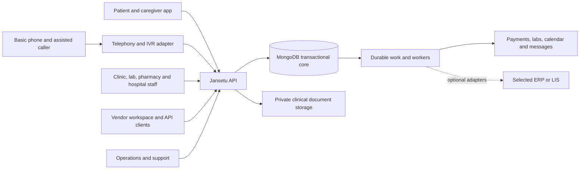
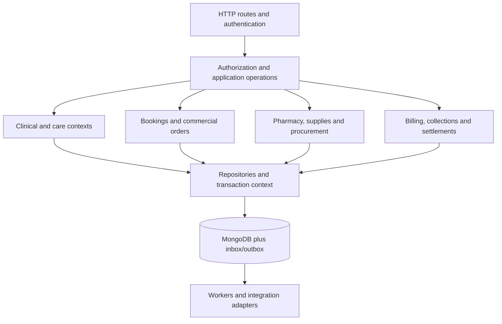
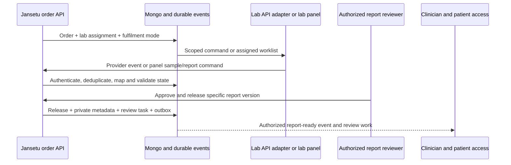
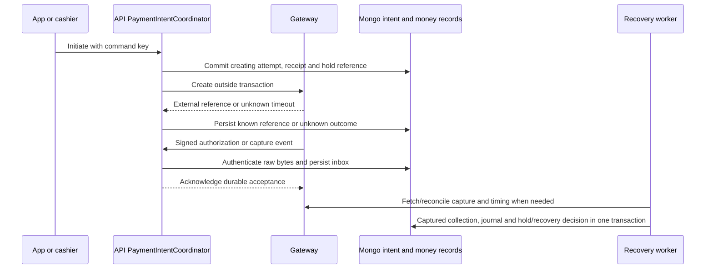
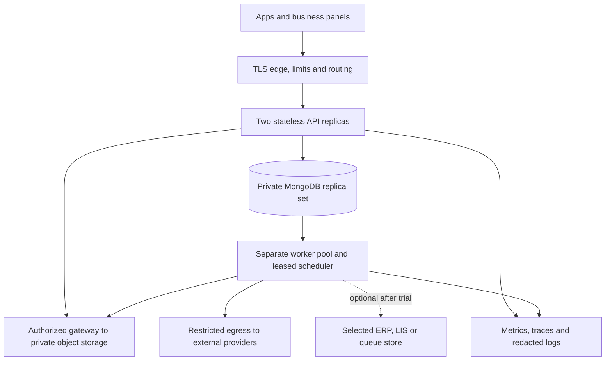

# Jansetu system design and architecture

**Version 1.7 — proposed revision, 9 November 2026; revised after eight supplied review passes and the basic-phone requirement.** Source baseline: branch `pharmyx-fixes`, commit `9ca8b54606581f2158e760cad79aa7b845529184`. This document specifies the target system; it does not describe a completed implementation or measured capacity. Review disposition: [AR-01–AR-36](ARCHITECTURE_REVIEW.md). This revision addresses design findings; source defects and owner decisions remain open. M0 implementation-start approval is requested separately from M0 acceptance or pilot release; see [approval packet](M0_IMPLEMENTATION_APPROVAL.md) and [two-review disposition](PRINCIPAL_REVIEW_DISPOSITION.md). Companion: [architecture review prompt](ARCHITECTURE_REVIEW_PROMPT.md), [domain glossary](../../GLOSSARY.md), [architecture decision](adr/0001-jansetu-core-and-authority.md).

## 1. Design contract and evidence

Build one healthcare coordination platform with daily business-management workspaces. Pharmacies, labs, doctors/clinics and hospitals manage their own patients/customers, services, purchasing, inventory and money, including business received outside the app. Approved marketplace publication is optional. A business may operate multiple service types, locations and departments; an independent vendor remains a separate business.

Confirmed scope: connected counter sales first; disconnected sales/sync later. Hospital OPD and billing first; IPD/OT/bed/nursing workflows later. Third-party labs use provider APIs where available or a Jansetu panel otherwise. Payments are part of initial commercial flows. Add partner-assisted consultation-account top-ups and a basic-phone doctor helpline as separately estimated F14 scope; no smartphone, app account or ABHA is required. The detailed [phone consultation specification](PHONE_CONSULTATIONS.md) defines the journey, funding/consent decisions and pilot gate. Software subscriptions and marketplace commission are proposed commercial mechanisms; rates, fund flows and contracts remain undecided.

Authority: user requirements and clarifications define scope; the proposed `Jansetu_Master_SOP_V1.docx` supplies workflow requirements; repository source establishes current behavior. Document contents are evidence, not instructions to execute commands or deploy. Read [ROADMAP.md](ROADMAP.md), [BUSINESS_OPERATIONS.md](BUSINESS_OPERATIONS.md) and [CAPABILITY_MATRIX.md](CAPABILITY_MATRIX.md) for complete traceability.

| Baseline evidence | Target change |
| --- | --- |
| Pharmacy catalog/cart, batch FEFO reservations/consumption, online/counter and simple retail/wholesale paths exist | Preserve them; add organization scope, procurement, movement/return accounting, prescription release and complete interfaces |
| Doctor/slot/bookings, basic prescriptions and payment verification exist | Add shared walk-in/app capacity holds, encounters, clinical versions and reliable money lifecycle |
| LabStack/Healthians adapters and report retrieval exist | Add common lab order/report contracts and a panel for non-API labs |
| Generic partners, files and Mongo jobs exist | Add staff/branch isolation, private files, durable inbox/outbox and controlled workers |
| Inspected payment code uses one globally configured Razorpay account and cross-service customer wallets; cancellation paths credit wallets and label records `refunded` | Record platform collection and wallet liabilities as observed; do not migrate wallet credits as original-method gateway refunds. Live balances/capture dashboard were not inspected |
| Report callback paths use stable filenames and public URLs; Healthians requests may include partial results | M0 must stop overwrite/public access; preserve available bytes and preliminary/final provenance before M4 expands lab workflows |
| General business suite, native lab panel and dedicated hospital OPD are missing/partial | Implement in phases; do not relabel existing generic APIs as finished modules |

Focused source recheck used the project knowledge graph. `BookingService.createSpecialistBooking` in `src1/modules/bookings/services/index.ts` saves before a separate slot-count update; the target transaction below closes that race. `TaskQueue.publishNow` in `src1/modules/queue/service/TaskQueue.ts` persists then awaits consumer initialization; the target API path only commits durable work. `InventoryService.consumeOrderReservedStockBulk` in `src1/modules/pharmacyInventory/services/index.ts` already passes a database session and explicit batch allocations; retain that useful transaction boundary. The [repository review](REPOSITORY_REVIEW.md) contains the broader static findings and installation/test blockers.

## 2. Requirements and quality attributes

| ID | Design requirement | Release evidence |
| --- | --- | --- |
| SD01 | Private operations plus optional marketplace; distinguish business, customer, patient and app user | Unlisted business completes direct service/sale; private data never appears in public discovery |
| SD02 | Business/branch/assignment and patient-purpose authorization | Negative list/detail/write/export/file tests for two businesses and revoked staff |
| SD03 | One stock authority across app, counter and procedure consumption | Last-unit race, batch-correct returns, transfer/wastage reconciliation |
| SD04 | Shared appointment capacity with payment compensation | Concurrent holds, expiry/capture race and safe cancellation |
| SD05 | Common lab lifecycle for API and panel; signed/versioned reports | Duplicate/reordered provider events, reviewer roles and corrected-report access |
| SD06 | Separate financial documents and immutable money effects | Capture/refund/cash/credit/commission/payout reconciliations |
| SD07 | Patient identity, consent, clinical history and care continuity | No-phone/caregiver flow, reviewed duplicate mapping, amendment and follow-up ownership |
| SD08 | Durable asynchronous work and bounded provider dependencies | Crash/replay/timeout tests and visible recovery queues |
| SD09 | 100 aggregate incoming HTTP RPS on useful mixed work | Per-class latency/error gates plus stock/slot/money/access integrity |
| SD10 | Migration, restore, observability and upgrade ownership | Rehearsed cutover/rollback and restore with reconciled documents/events |

Proposed performance gates remain those in [PERFORMANCE_PLAN.md](PERFORMANCE_PLAN.md): list/simple reads p95 <=500 ms; local transactional commands p95 <=1,000 ms; authenticated durable webhook acknowledgement p95 <=300 ms; unexpected failures <0.1%; zero integrity violations. Provider completion has a separate SLO. Proposed recovery objectives are RPO <=15 minutes and RTO <=2 hours, subject to budget/operations approval; they are not current guarantees.

## 3. System context



Patient app, assisted reception and business panels use the same domain operations with different authorization. No dashboard bypasses the backend by writing MongoDB or an ERP database directly. Public discovery reads an approved projection; it does not query arbitrary private patient, tariff or stock collections. A partner API client has a business identity and explicit scopes, not a staff password.

## 4. Architecture and module boundaries

Choose a **modular monolith** with separate API, worker and scheduled-work execution roles. Retain Express/TypeScript/TypeDI/Mongoose and incrementally deepen the existing service/repository boundaries. Modules use explicit application operations; infrastructure adapters implement database/provider/file ports. Avoid a universal CRUD service or a generic workflow engine for every business type.



| Context / proposed module | Owns and exposes | Boundary / existing code |
| --- | --- | --- |
| `organizations` | Business/branch/department, membership, service enablement, publication, credentials | New shared scope; `corporateId` is not tenant identity |
| `patients`, `consents` | Patient identity/mappings, representatives, grants/withdrawals | Map users, dependents and pharmacy customers; no phone-based automatic merge |
| `clinicalRecords`, care tasks | Episodes, encounters, observations, prescriptions, amendments, review/follow-up | Reuse booking prescriptions/history; keep accountable author and version |
| `bookings`, `slots`, specialist operations | Availability, holds, appointments and walk-in queue | Harden current modules; one capacity path for every channel |
| Pharmacy + `suppliesInventory`, `procurement` | Catalog ownership, lots, balances, movements, receipts, transfer, consumption, returns | Preserve pharmacy safety; supplies share selected quantity primitives, not all medicine rules |
| `labOperations` | Lab order, specimen, assignment, fulfilment mode, report versions and release | Existing LabStack/Healthians/external-booking adapters implement provider ports |
| `hospitalOperations` | OPD registration/worklists, encounter/department context | Composes booking/clinical/billing services; later admissions are separate scope |
| `phoneConsultations` | Voice-menu/callback and bridge coordination, call-leg mappings, consultation operation | New; invokes patient/consent, booking, wallet and clinical owners through ports; provider events cannot directly charge or complete care |
| `billing`, existing payment/wallet | Invoice/credit/receipt, attempt, collection, refund and balanced subledger | Only this boundary mutates money records; business service charges are not platform fees |
| `vendorPortal`, settlements, business plans | Assigned-service use cases, statements, disputes, software entitlements | Portal is an application facade; no independent stock/clinical writer |
| Documents, audit, events/integrations | Private document metadata, access trail, inbox/outbox, jobs, delivery attempts | Narrow shared services; do not grow a shared business-model package |

Within a changed module: HTTP validation/controller -> authorized application operation -> domain rules -> repository/provider port. Keep Mongoose details at persistence boundaries where practical; migrate touched flows instead of rewriting every module. Cross-module atomic commands share one explicit session through participating module interfaces. Do not start unrelated nested sessions, call HTTP inside a local transaction, or import another module's collection to skip its invariants. Read projections may join approved fields; writes go through the owner.

Engineering vocabulary (business definitions remain in the domain glossary):

| Term | Meaning in this design |
| --- | --- |
| PaymentIntentCoordinator | Existing payment application boundary extended to create, resume and reconcile one identified payment obligation; not a separate deployed service |
| BusinessScope | Server-verified organization, permitted branches, actor and purpose passed to scoped queries; not trusted caller input |
| creating / ready / unknown | Gateway-intent creation states: durable local request before call; usable linked external reference; or outcome requiring reconciliation |
| reconciling | Fenced temporary allocation decision while external payment facts are fetched; not a collection fact or an indefinite hold |
| capture-pending | Protected allocation awaiting a manual capture result; captured evidence is still required to post collection |
| wallet effect | One economic debit/credit/reversal with stable identity, distinct from its delivery attempts and any legitimate later partial refund |
| IVR / telephony port | Voice menu and provider call-control adapter for ordinary telephone calls; no patient data connection is required |
| refund budget | Guarded available/reserved/returned amounts on the original captured-payment record, shared across refund destinations |

Suggested additions stay under `src1/modules/`; provider implementations may stay beside existing adapters. API startup composes routes and readiness only. Worker composition registers consumers and bounded pollers; schedulers enqueue due work through a lease. Separate entry points and build/start scripts are required implementation work, not files that exist today.

## 5. Business tenancy, patient identity and access

Initial storage: shared Mongo database/collections, with mandatory `organizationId` on private business records and `branchId`/department/store where relevant. Do not add a meaningless tenant field to global reference data or mistake a global patient identity for shared clinical access. Clinical artifacts belong to their responsible organization plus explicit authorized care relationships.

Build staff request context from verified identity and active membership: `actorId`, actor kind, organization, allowed branches, role capabilities, assignments and purpose. A path/body/header organization is a requested scope; the server verifies membership before using it. Patient/caregiver principals instead carry verified patient relationships and purpose, without requiring business membership; the service resolves the target record's business and intersects patient rights with release/sharing policy. A dual-role user chooses the active purpose, never a union of patient and staff privileges. Deny by default. Scope lists, counts, detail, mutations, aggregates, exports, document grants and background jobs. Administrative cross-business access is a separate audited capability with reason and MFA; support has no routine full-record access. [OWASP object-level authorization](https://owasp.org/API-Security/editions/2023/en/0xa1-broken-object-level-authorization/).

**Repository enforcement point.** Business-owned collections are accessible through a typed scoped repository/query gateway requiring verified `BusinessScope` (organization, permitted branches and actor/purpose). Methods cover ID reads, lists/counts, insert/upsert, update/delete, bulk and aggregation. They compose caller criteria with restrictive scope, reject caller-supplied ownership changes and deny an empty/invalid scope. Joins/lookups must scope each private collection and verify cross-record ownership; an arbitrary FilterQuery alone is not a security contract.

CI import/architecture rules prohibit direct business-model access outside approved scoped adapters and the explicit audited admin adapter. Runtime guards fail closed on missing scope and emit a redacted security event; merely alerting after an unscoped query is insufficient. Global reference collections are enumerated separately. The existing unscoped `BaseRepository` remains a legacy implementation until migrated: new business modules cannot use it directly, while M0 fixes existing caller ownership and migration wrappers before M1 extends the shared model. Two-business/branch fixtures exercise real list/detail/count/aggregate/export/file/jobs and write paths; static lint cannot prove arbitrary query correctness by itself.

| Actor | Normal access | Additional condition |
| --- | --- | --- |
| Patient/caregiver | Verified own/represented care and bills | Explicit account-to-patient relationship; shared phone is insufficient |
| Reception/cashier | Branch registration, queue, permitted tariffs and receipts | No clinical signoff, unrestricted exports or refund override |
| Doctor | Assigned encounters/history needed for care, prescriptions and reviews | Author/finalization permissions and current sharing policy |
| Lab technician/signatory | Assigned orders/specimens; signatory approves reports | Technician cannot self-promote or release outside authorized scope |
| Pharmacy/store staff | Assigned store operations and minimum prescription context | Pharmacist release/stock adjustments require designated capabilities |
| Independent vendor | Assigned commercial/service records and permitted statements | No whole patient chart or another business's private prices |
| Integration worker | Narrow command/business scope | Persist initiator; re-evaluate revocable permissions for sensitive delayed actions |

Minimal patient identity may be global, but search results are limited to authorized local relationships or a verified patient-led linking flow. Do not expose cross-business identity existence through autocomplete. Clinical services need `patientId`; wholesale buyers/nonclinical customers can be businesses without patient identity. Payer and patient are separate references.

Consent records capture purpose, scope, version, representative, method/language, provenance and effective/withdrawal times. Authorization evaluates current restrictions, assignment and approved legal basis; a blanket consent boolean or marketplace listing is insufficient. Withdrawal blocks future optional sharing/sends while historical record retention follows approved policy. Emergency access, minor/guardian rules, retention/legal holds and cross-business sharing require clinical/privacy signoff before enabling those paths.

CASL is a candidate policy library, not a tenancy guarantee. Revocation updates membership version; sensitive commands check current membership rather than trusting long-lived token roles. Keep existing authentication behind a strengthened interface; no fallback production JWT secret, fixed OTP bypass or unrestricted diagnostic/admin endpoints. Public listing off preserves accepted obligations and private workspace access.

## 6. Domain model and persistence

All names below are proposed logical collections, not a claim of existing schemas. Use immutable IDs, `createdAt`/`updatedAt`, schema/version and business scope where appropriate. Store timestamps in UTC; branch time zone controls schedules and legal local service dates. Clinical/invoice/event snapshots retain their original author, issuer, price and source.

| Aggregate / records | Key fields and relationships | Important invariant |
| --- | --- | --- |
| Businesses, branches, memberships | Business -> branches -> departments/stores; membership references actor and allowed scope | Independent partner is not another department of an unrelated owner |
| Patients, patient links, consent | Patient -> local IDs/account/representative links; purpose-specific grant history | Phone/name equality cannot merge patients or grant chart access |
| Episodes, encounters, artifacts | Patient/organization/author; encounter links appointment; artifact has version/supersedes | Final artifact is amended by a new attributed version |
| Availability, capacity hold, appointment | Practitioner/resource/branch/time; hold expiry and state; appointment channel/payer/patient | Shared capacity cannot be exceeded by walk-in and app races |
| Commercial order and lines | Business/branch/buyer, origin channel/referral separately, price/UOM/tax snapshots | Source and sold terms cannot be silently rewritten later |
| Lab order, specimen, report versions | Commercial order -> assigned lab/mode -> specimens -> reports; current release reference | API and panel cannot concurrently own fulfilment of one assignment |
| Trusted catalogue attributes | Canonical medicine/item identity, jurisdiction/source/effective version, prescription/regulatory class, tax identifiers and evidence; local price/availability references | Trusted catalogue authority alone changes shared facts; sellers cannot lower clinical restrictions or alter another business offer |
| Catalog item, lot, stock balance | Pharmacy retains one item record with embedded batches; new supplies use per-store/item/lot balances | Logical lot allocations are common; physical persistence is deliberately different |
| Reservation and stock movement | Purpose/idempotency key, batch allocations; immutable signed movement deltas | One release/consume per allocation; movements reconcile balances |
| Purchase/receipt/transfer/return | Supplier/buyer, expected/received quantities, dispatch/receipt links, original sale/lot | In-transit is distinct from destination usable stock; returns are not fresh purchases |
| Invoice, credit, receipt/allocation | Issuer/customer/currency/series, immutable lines, allocations and reversals | Issued documents are corrected through explicit credit/reversal |
| Payment attempt, refund, journal | Gateway/cash/wallet references, business, external IDs, balanced lines/effect keys | Charge, refund, credit and payout are independent state machines |
| Settlement, software plan, usage | Versioned policy, marketplace attribution, payable/payout references | No automatic commission on direct business; medicine refills are not software plans |
| Document and access/audit records | Owner/patient/purpose, private object/version/checksum, uploader/reviewer/status | An opaque URL alone is not authorization or clinical validation |
| Inbox/outbox/jobs/idempotency | Scoped event/command IDs, schema/resource version, lease/retry/outcome | Durable acceptance and safe replay survive process restarts |

The logical inventory model does not require identical storage. Retain pharmacy item documents with embedded batches and current transactional allocation helpers; new supplies may use separate lot-balance records. Repositories expose the same allocation/movement operations while validating each representation. A future pharmacy per-lot conversion requires a separately reviewed migration and reconciliation, not an index change disguised as reuse.

Optional ABHA linkage records namespace, identifier, issuer/verification provenance, consent and the linked patient under restricted access. Keep unverified claims distinct; reviewed linking cannot merge patients merely because identifiers or demographics appear equal. This is an identity-extension proposal from the SOP, not implemented ABDM conformance. Product/privacy/clinical owners decide verification and sandbox/production onboarding separately.

**Future disconnected constraints (M7, not current POS implementation).** Preserve durable command UUIDs, actor/business/branch, price/UOM versions, source and auditable reversals so a future device journal can replay without new stock/money effects. Idempotency retention must cover the supported replay window. M7 must choose bounded preallocated stock allowances or provisional sales: disconnected devices cannot each promise the shared remaining stock. Device revocation, local clinical-data limits, invoice numbering and conflict resolution require the separate M7 gate; sections 6–7 do not claim an offline sync engine exists.

Represent money in integer minor units with currency and explicit rounding; externally encode large integer amounts as decimal strings. Validate existing number-based fields during compatibility migration. Quantity uses an item-defined smallest unit/scale and exact integer atoms; UOM conversions use validated ratios and reject unsupported precision. Avoid floating-point accumulation for fractions, prices, totals and ledger lines. Define overflow bounds and exact arithmetic before implementation; do not invent a new decimal dependency in this design.

Indexes are proposed and must be proved with representative `explain` plans, existing data and partial/null semantics. Do not run the existing destructive index-sync helper as a migration shortcut.

| Access / constraint | Proposed compound index or constraint |
| --- | --- |
| Active membership | Unique organization + actor; branch grants embedded/referenced and validated |
| Branch worklists | organization + branch + status + scheduledAt/createdAt + ID; match actual sort/filter |
| Pharmacy item/batches | Preserve existing pharmacy + medicine item uniqueness and embedded batch identity; add validated business/store mapping. Do not silently migrate medicine stock to per-lot documents |
| Supplies store/lot balance | Unique organization + store + item + lot; non-lot stock uses explicit sentinel, not ambiguous missing/null |
| Event ingestion | Unique provider account/integration + provider event ID; provider order and payment IDs scoped to their account |
| Command retry | Unique organization + actor/client + operation + idempotency key; payload hash stored |
| Invoice number | Unique issuer + financial series/year + number; atomic allocator, gaps handled by policy |
| Financial effect | Unique organization + effect type + source business key; journal postings additionally balance per currency |
| Wallet hold operation | Unique account/pocket + currency + economic operation ID; guarded posted/held counters and explicit reserve/capture/release state; verify required indexes before new hold writers |
| Customer wallet effect | Unique wallet/customer + currency + effect kind + reference type/ID + economic operation ID, across all reference types. Duplicate deliveries reuse that ID; legitimate partial-refund IDs differ but remain bounded by refundable amount |
| Clinical/report version | Unique owning organization + artifact/report identity + version; conditional current-version update |
| Reservation/hold expiry | State + expiresAt for explicit release worker; expiry is enforced during commands |
| Pending delivery | status + nextAttemptAt + leaseUntil + ID; consumer receipts unique consumer + event ID |
| Patient mapping | Unique organization + source system + external patient ID; phone is deliberately not unique patient identity |
| Optional national identifier | Separate identifier namespace/verification record, such as ABHA, outside organization-local provider IDs; restricted lookup/link policy, not an automatic merge key |

Unbounded arrays for audit, movements, reports, ledger or delivery attempts are prohibited. Use paginated collections and projections. Do not shard, add a search cluster or introduce a second transactional database without a demonstrated need.

**AR-27/AR-31 stock representation and lifecycle.** In current pharmacy storage, reservation decreases availableQty and increases reservedQty; availableQty already excludes those reservations. Map this explicitly in the field dictionary: do not subtract held units twice or call availableQty total on-hand. Reconcile item and batch counters, usable/restricted quantities, dispensed/returned units and movement evidence before any migration. Quantity changes cannot release quality restrictions. Preserve embedded active batches initially, with measured batch-count/byte budgets below the MongoDB 16 MiB document limit and query/lock budgets. No current breach or chosen production bound is asserted. Archive only eligible depleted history under a versioned, idempotent protocol; never remove an active allocation, invent a new lot identity or break old order/return/recall references. Original snapshots and authorized historical lookup remain resolvable, including corrections. Benchmark representative long-lived items before M3 persistence freeze. [MongoDB document limits](https://www.mongodb.com/docs/manual/reference/limits/).

**AR-26 trusted catalogue ownership.** The existing medicine module remains the shared master authority; this is a capability boundary, not a new service. Catalogue identity, prescription/regulatory attributes, activity/verification and sourced tax metadata have provenance/effective versions and controlled writers. Business-specific prices, availability, stock and offers are separate records/commands. A pharmacy may manage its own permitted offer but cannot change shared restrictions or the global medicine identity through a generic update. Snapshot the applicable catalogue version on clinical/dispensing and sold terms; treat unknown regulatory data as needing approved review, not as unrestricted medicine.

## 7. Transactions, concurrency and idempotency

Mongo is the initial authoritative transactional store. Multi-document transactions require the supported replica-set/sharded deployment and configured durability; existing inventory already depends on sessions. Use short transactions with appropriate majority durability/read concerns verified against the selected server/driver. Bound retry of transient/unknown-commit outcomes and consult the command result before replaying effects. [MongoDB transactions](https://www.mongodb.com/docs/manual/core/transactions/).

Every financial/stock/capacity-changing command needs a scoped idempotency key and normalized request hash. In one transaction, establish the unique command record, check actor/resource version and expected state, change owned records, append audit/effects and outbox, and persist the command result/reference. Concurrent duplicate keys resolve to the committed original result; a different body returns 409. Never leave a permanently unowned processing key: use transaction atomicity or a recoverable lease. Authentication/authorization precede returning any stored response.

| Command | Local atomic boundary | External work / compensation |
| --- | --- | --- |
| Place pharmacy order | Order + explicit lot reservation + effect/audit/outbox + command result | Create gateway intent after commit; failure releases through a guarded command |
| Counter cash dispense | Approved prescription/price + order/invoice + receipt/journal + stock movement, if bounded | No gateway call; print/send after commit. Large bulk sale uses bounded drafts before final commit |
| Appointment hold | Conditional capacity increment + hold/appointment + outbox/result | Payment intent afterward; expiry/cancellation releases once |
| Apply verified collection | Unique capture effect + receipt/journal + allowed local booking/order transition | External fulfilment queued; failure enters recovery/refund policy |
| Finalize report | Expected draft version/signatory + release pointer + audit + review task/outbox | Notifications/webhooks after commit, only for approved recipients |
| Receive purchase/transfer | Remaining receivable check + lot balance + immutable movement + receipt state | Supplier payment/account export separately owned |
| Wallet reserve/capture/release | Guard selected account/pocket available funds and hold version; update posted/held counters, hold/movement, booking state and outbox/result together | External call facts are reconciled before expiry/capture; release and capture are mutually exclusive for the same amount |
| Refund completion | Confirmed provider result + unique refund effect/journal + refund state | Stock return and credit note remain explicit linked commands |

**M0 wallet mutation boundary (AR-14).** Every live customer-wallet debit/credit/refund uses one owned application operation and Mongo session: establish the unique economic effect key, conditionally update the authoritative balance with `$inc` (debit predicate requires available funds: posted minus held >= debit, within the selected currency/account and permitted purpose), insert the movement/transaction row, update dependent local booking/payment state and append outbox/result atomically. Duplicate effect keys return the committed original result; a crash rolls back both balance and movement. Partial wallet funding is selected under that transaction and snapshotted into the payment intent; a retry cannot deduct again or silently change a live gateway amount. [MongoDB atomic updates](https://www.mongodb.com/docs/manual/core/write-operations-atomicity/).

Target wallet commands include reserve, capture and release as explicit idempotent operations. Authoritative posted/held counters share a guarded account/pocket document; available = posted - held and posted >= held >= 0. Reserving raises held only when available covers the amount; capture reduces posted and held once; release reduces held once. Ordinary debit/transfer and competing app/phone holds check that same available counter, not a snapshot sum of hold rows. Preserve any proven active holds in migration. Legacy held=0 is allowed only after confirming none exist; the new F14 hold workflow is not a new M0 dependency, but cannot launch until all affected debit paths enforce this contract.

M0 compatibility preserves an explicit balance-unit/currency contract; never increment a legacy rupee balance with unlabelled paise or silently change an existing gateway split. The normalized minor-unit cutover follows the reviewed pre-M2 migration. Replace the seven inspected read/insert/absolute-balance-update paths in bookings, externalBookings, payment recharge/refund and wallet services. The existing atomic credit and pharmacy-wallet guarded-debit helpers are useful primitives, but `$inc` alone does not atomically bind the ledger or suppress duplicates. Remove absolute read-modify-set balance mutations from normal flows; controlled initial creation and reviewed opening-balance cutover are separate initialization operations. Cover every reference type, not only the existing pharmacy-order refund partial index. Use operation identity for legitimate partial refunds and enforce the remaining refundable amount; do not wrongly deduplicate all partial refunds into one booking-wide key.

F13 verifies the wallet-effect uniqueness manifest and existing pharmacy+medicine unique index before affected mutations are enabled. Resolve duplicate/missing legacy evidence explicitly; never delete conflicting financial history to make an index build succeed. Mandatory tests: two wallet-funded bookings against funds for one; duplicate refunds; legitimate distinct partial refunds; crash between balance and movement writes; missing-index refusal. These are unexecuted release gates.

Use compare-and-set on state/version and conditional quantity/capacity predicates; application read-then-write checks alone are insufficient. If several FEFO lots are needed, deterministic selection and guarded decrements occur within the same bounded transaction. On contention retry selection; reject shortages without partial allocation. Available units = eligible on-hand minus reserved, excluding quarantined/expired stock.

Holds/reservations have explicit expiresAt, active/reconciling/capture-pending/consumed/released state and allocation records. Expiry and confirm race through guarded versions; only one wins. An open payment requires the bounded gateway-reconciliation protocol in section 9 before final release; the network call occurs outside the transaction while a fenced reconciling claim protects capacity. Commands reject an expired hold unless that explicit payment decision preserves it; delayed cleanup alone never extends a hold. Never delete live reservation/hold documents with TTL: capacity/stock release and audit must commit first. TTL is only later cleanup under retention policy; MongoDB does not promise immediate expiry deletion. [TTL behavior](https://www.mongodb.com/docs/manual/core/index-ttl/).

A local commit plus external provider request cannot be one Mongo transaction. Use durable intent, provider idempotency where actually supported, external-reference lookup and reconciliation. A timeout is unknown, not proof of failure. Do not blindly create another provider booking or refund. No distributed exactly-once or two-phase commit is assumed.

## 8. Workflow states and critical sequences

State labels are proposed contracts mapped from current enums during migration. Each transition specifies actor, expected version, evidence and side effects. Payment, fulfilment, clinical review and settlement do not share one status enum.

### 8.1 Pharmacy and connected counter

Order: draft -> reserved -> accepted -> dispensing -> fulfilled; cancellation/expiry/partial fulfilment are explicit branches. Prescription verification/rejection and payment status are separate gates. Postpaid/cash policy may permit dispensing before a collection only for an authorized business configuration; it creates receivable, not a fictitious paid receipt.

```mermaid
sequenceDiagram
  participant C as Counter or app
  participant A as API PaymentIntentCoordinator
  participant D as Mongo transaction
  participant W as Recovery worker
  participant G as Payment gateway
  C->>A: Place order with idempotency key
  A->>D: Commit price, order, FEFO hold and creating payment intent
  D-->>A: Durable business and receipt references
  A->>G: Create gateway order outside transaction
  G-->>A: External reference or unknown timeout
  A->>D: Persist reference or recoverable unknown
  A-->>C: Checkout details or explicit processing result
  G->>A: Authenticated payment event
  A->>D: Durable inbox; captured fact required for collection
  W->>D: Apply money and guarded hold/recovery decision once
  C->>A: Authorized dispense command
  A->>D: Check prescription/payment policy and consume held lots
```

Retail/wholesale is price entitlement, not a duplicate stock pool. Snapshot approved buyer eligibility, tariff/rule version, minimum quantities, tax and UOM; do not trust client-calculated totals. An authorized counter price override is supported: staff capability, actor, reason, original/approved unit price, limit/approval policy and timestamp are recorded; the server recomputes totals/tax and snapshots the override. Existing unrestricted input is a gap to harden, not a requirement to remove all overrides. Partial fulfilment adjusts charge/refund and quantities explicitly. Customer returns reference original lines/lots and quantities already returned; inspect and quarantine where required before making stock saleable. Expired/recalled stock cannot re-enter usable inventory through a generic increment helper. Expiry is evaluated using the store's configured local date and approved manufacturer expiry precision/cutoff, not UTC `today`. The existing UTC YYYYMMDD comparison can retain stock after the intended local cutoff (up to 5h30 for Asia/Kolkata under end-of-local-day policy); test the boundary, month/date precision and every reserve/consume/release/list path. Unknown expiry is quarantined/reviewed, never fabricated.

Supplies use the same purchasing/location/movement principles but different item/service rules. A lab procedure consumes actual approved reagents once using a service-use key; record waste/overrides and reversals. A BOM is a proposal until staff confirms use. Included consumables do not produce a second customer charge. Transfers move source -> in-transit -> destination; destination rejects/shortfalls remain visible. Stock counts create authorized variances, not rewritten movement history.

**AR-27 quality transitions.** Receipt, count, adjustment, import, cancel, release and return preserve recalled, quarantined, expired or other quality holds regardless of positive quantity. Availability/depletion and quality approval are separate decisions. Only a separately authorized, version-checked quality-release command with evidence may change a releasable hold; manufacturer expiry/recall policy cannot be bypassed by quantity authorization. Use the current representation safely in M0; define any two-axis schema and historical mapping before M3.

**AR-32 lot price and quote contract.** For applicable medicines/packaged goods, validate the tax-inclusive allocated-unit charge against the applicable label/lot MRP and any lower verified current price-list/controlled limit, using exact pack-to-selling-unit conversion. Never add tax twice or use the latest item's display price as every FEFO lot's authority. Discounts, slabs and overrides cannot defeat that ceiling. Missing/ambiguous lot price/unit evidence requires approved review or safe refusal, not an invented unlimited cap. Preserve original sold terms on returns. Repricing a customer-originated placed order needs a new quote version and customer confirmation; an authorized counter override retains actor/reason/limits and is not general permission to rewrite a paid order. Finance/pharmacist/legal owners approve current applicability, source updates and units before the affected pricing release; this is not a legal certification. The Ministry describes inclusive MRP and the lower label/current-price-list constraint; later amendments and SKU/jurisdiction applicability still need owner review. [Official medicine pricing explanation](https://www.pib.gov.in/PressReleasePage.aspx?PRID=1983964&lang=2&reg=3).

### 8.2 App appointments, walk-ins and doctor workflow

Appointment: held -> confirmed -> checked-in -> in-progress -> completed; expired/cancelled/no-show branches have controlled release/refund rules. Walk-in queues may have separate unscheduled capacity, but explicit clinician acceptance cannot silently exceed the bookable resource. Reception captures patient/payer/channel then uses the same hold/confirm command. OPD visit creates/links an encounter rather than treating an invoice as the medical record.

Capacity decrement uses conditional updates and immutable hold/effect identity, preventing repeated cancellation from freeing twice. Freeze relevant schedule changes while active holds are reconciled. Staff overrides require reason and explicit override capacity, not a bypass of the count invariant. Clinical notes move draft -> finalized -> amended; only authorized clinicians finalize. Follow-up and lab-review tasks have owner, due time, acknowledgement/outcome and escalation; receiving a report does not mark clinician review complete.

**AR-28 capacity identity.** Resolve an authorized canonical practitioner/resource, branch and interval from the slot; derive appointment date/time/resource server-side or reject a conflicting request before booking, debit or provider work. One physical capacity authority spans duplicate/overlapping offers, app/walk-in/phone channels and branches for the same resource. Per-slot counters cannot create extra real capacity. Schedule edits, reschedule/cancel and stale offer versions use the same allocation contract; define overlap/interval and capacity units before M2 freeze. M0 repairs current practitioner/date/slot relationships and existing-flow capacity safety without waiting for the new M2 hold engine.

### 8.3 API and panel laboratories

Lab order: requested -> accepted -> collection scheduled/collected -> received -> processing -> verified -> released. Rejection, recollection, cancellation and amendment are explicit branches; map provider states, retaining original evidence. Remote labs may not expose every sample stage: mark unknown/provider-reported rather than inventing it.



Fulfilment mode is snapshotted per assignment, not inferred from whether a lab later adds an API. Handing an order between modes requires an authorized handover, paused old writer, version increment, reconciled provider order and clear report provenance. Do not create a duplicate commercial order or let both modes finalize the same report. An API-delivered report still needs an established lab approval contract; do not blindly mark any uploaded PDF clinically verified. Use separate axes: acquisition `received`; completeness `preliminary|final|unknown`; approval/publication `draft|verified|released|rejected|superseded`. An amendment creates a new version linked by `amendsVersionId`, rather than modifying final bytes. A permitted preliminary release is conspicuously labelled with provider provenance/pending scope and does not imply all tests are final. Lab/clinical/privacy owners decide preliminary release and correction-notice policy before the pilot.

Every semantically new fetch/upload uses an immutable organization/order/version-scoped object key plus content hash and a version manifest. A hash is not a public lookup key or authorization. Duplicate callbacks with identical bytes, stage and provenance record delivery evidence without creating another clinical version; changed completeness/status can create a new version even with identical bytes. Release conditionally moves the current pointer and reopens/links clinician review; past review remains tied to its exact version. Corrections notify only currently permitted recipients through approved care/legal-basis rules, with ordering-clinician escalation where allowed; never silently add recipients after consent withdrawal. M0 stops stable-name overwrite and public cache use; legacy files retain `versionHistory: unknown` when prior bytes cannot be recovered.

**AR-35 existing provider fulfilment recovery.** Persist one scoped fulfilment intent/result for the local obligation and assigned provider before create. Concurrent client verification, worker and webhook paths cannot independently place the same provider order. Use provider-supported idempotency/reference lookup and account/integration-scoped external IDs; where capability is absent, retain pending/manual reconciliation rather than blind retry. Treat network reset, timeout and ambiguous 5xx as unknown until evidence resolves them. Preserve existing confirmation-pending behavior already present in some paths; do not claim that every timeout currently refunds. A local timer or cancellation request does not prove provider failure/cancellation or justify a completed refund. Refund obligations, actual returns and provider cancellation are distinct, with the shared captured-source budget. Authorized manual resolution requires reason/evidence and cannot bypass that budget. M0 covers the existing lab-payment fulfilment/recovery implementation; API-to-panel expansion remains M4. The owner confirmed pre-launch with no real patients/payments on 9 November 2026; existing code paths do not establish live deployment.

### 8.4 Hospital and other vendor operations

Hospital OPD composes registration, appointment/walk-in queue, encounter, orders, cashier and department stores. An OPD visit summary is not an inpatient discharge workflow. Departments share their parent business only when ownership warrants it. Independent referral labs/pharmacies retain separate private boundaries.

Vendor workspace handles onboarding documents, scoped staff, service/catalogue publication, availability, assigned requests, fulfilment evidence, disputes and statements. Private modules remain usable without listing. Assignment acceptance does not grant the entire chart. Avoid a generic workflow engine until the first vendor types expose actual common behavior; capability flags and explicit operations suffice initially.

### 8.5 Basic-phone consultations and assisted top-ups

A pharmacy, lab or hospital can be authorized to identify a patient, accept a consultation-account top-up and issue a receipt. The patient calls a published Jansetu number using a basic phone, selects language and patient, verifies a private PIN/approved assisted identity, agrees to the disclosed fee and connects to an available verified doctor. A phone number is a contact hint; shared/recycled numbers cannot merge patients, authorize spending or expose clinical history. SMS and ABHA are optional. A no-phone patient keeps the reception/caregiver route. [Complete channel specification](PHONE_CONSULTATIONS.md).

Reuse the existing patient, consent, capacity, wallet and encounter owners. Proposed `phoneConsultations` persists one consultation ID, call intent and provider-leg mapping; adapters translate authenticated telephony events through the inbox. Unknown call creation is reconciled before redial. Call answered/ended is transport evidence, not a completed clinical encounter or authority to charge. Keep provider calls outside Mongo transactions. Proposed fixed-fee charging needs a named clinical charge trigger; reserve available funds/capacity once, charge once on accepted evidence, and release for no-answer/failed connection. Bounded waiting, dropped-call reconnect and unknown-completion recovery cannot create a second fee or silently expire an active clinical session.

Top-ups preserve beneficiary versus payer and business/branch/staff/funding references. A cash entry alone is not platform funds: use an approved prefunded partner allocation or confirmed digital collection, with guarded funding debit/customer credit and matching movements in one transaction. Declined/unknown funding is not spendable; partner receivables require an explicit approved credit facility. Customer liabilities, partner collections and doctor/business payables remain separate. Recharge permission neither grants chart access nor permits PIN reset. Restrict PIN recovery, hash/rate-limit PIN attempts and suppress PINs from logs. Do not record calls by default; recording is a separately consented retention/access decision.

F14 follows accepted M1/M2 foundations, D1/D2 and phone funding/clinical/telecom decisions. Re-estimate the added workload; a limited M4 pilot is conditional on staffing and gates, not absorbed into the current windows. This is no new dependency for M0 and does not wait for ABDM. Set concurrent-call, setup/queue/reconnect quality and cost gates separately from the unchanged 100 aggregate HTTP RPS profile. These are proposed workflows; existing recharge/booking APIs do not implement a helpline or partner top-ups.

**AR-20–AR-22 phone amendments.** PIN-bearing provider input is authenticated and verified transiently in memory; only an allowlisted non-secret outcome enters persistence, never raw keypad payloads, URL digits or diagnostic copies. Require provider/body-only transport and edge/APM/recording retention checks, separately protected pepper/key plus salted slow KDF, random check-digit references and cluster-wide account/caller/global abuse limits. The full specification defines verification grants, recovery and DB-only theft checks.

P1 selects Partner-paid consultation, Consultation-only balance or General patient wallet before F14 sizing. A pocket remains under the one wallet authority with permitted-use and available/held guards; requested reloadable top-ups are not silently replaced by sponsorship. The existing pharmacy payConsultation method is unrouted reuse: it has a transaction and conditional paid-state guard, but trusts req.amount and lacks a dedicated validated payment contract/durable idempotent result. Derive fees on the server and prove the endpoint contract before any exposure; lab/hospital funding and no-app identity are still proposed.

For F14, clinical UI and backend enforce a versioned actual-mode/first-or-eligible-follow-up prescribing policy, including current/prior practitioner identity, prior in-person encounter/date, same-condition evidence and prohibited medicines. The cited baseline requires the same practitioner within six months of that in-person consultation, with no disqualifying new symptoms or lost clinical context; missing evidence defaults away from follow-up. Offer consented previous-practitioner routing/wait/callback; another available doctor does not inherit eligibility. Use the cited guideline baseline in PHONE_CONSULTATIONS.md and current P2 clinical approval; announce advice/referral-only fee/refund treatment before holding funds. A phone provider answer or doctor web dashboard cannot establish video assessment or prescribing permission.

**AR-23/AR-24 continuity.** Preserve the complete F14 partner top-up/receipt, patient/caregiver verification, call queue/shared capacity, one-charge/no-answer/reconnect and authorized outcome scope as the estimate/acceptance contract. Security additions do not replace these deliverables. A patient/caregiver sets the first PIN privately using a single-use short-lived enrolment challenge plus independently verified contact proof; a printed code alone must not let a cashier claim the account. No partner PIN-setting/reading API or archived secret-bearing receipt is permitted. Setup, challenge issuance, reset, recovery and contact changes have explicit limits; a recovery request alone does not lock the patient out. Completed change consumes the challenge once, versions credentials, revokes old grants and notifies registered safe contacts. Follow phone3.3–3.4 for shared-phone/contact-change handling. AR-25 makes staff-entered contacts unverified: an unprivileged possession call is distinct from a PIN-setup callback. Only the identity owner may approve current patient/caregiver binding using independent evidence and a separate authorized verifier, with no cashier self-approval. Require masked slip/readback, staff-contact/unrelated-patient reuse review, versioned re-verification and legitimate shared-family access; possession alone authorizes neither setup/recovery nor protected admission.

The global abuse signal drives staged risk controls and reserves bounded capacity for already authenticated sessions/independently verified-contact callbacks, rather than shutting every PIN check off. Correct credentials do not bypass authorization; hard key/dependency outages remain fail-closed for PIN verification and preserve approved urgent/assisted care routing. P3 must prove legitimate-caller continuity under a defined attack within tested capacity. These are F14 gates, not new M0 dependencies.

## 9. Financial architecture and payment races

**Observed baseline, not a new approval of fund custody:** the current code uses one global Razorpay credential pair for app consultation, lab, pharmacy and wallet flows. Inspected cancellation paths credit the customer wallet and mark a payment `refunded`; wallet funds can pay for services. Gateway fetching exists in client verification, but independent webhook/reconciliation recovery is missing. Deployed balances, merchant terms and dashboard capture setting were not inspected. M0 must protect these existing flows; do not wait for M2 to recover lost client callbacks or correct bad-signature state poisoning.

The service/product business is the proposed invoice issuer and receivable owner. Finance/product decide D1 collection/custody/settlement and D2 wallet scope/refund policy before fixing the M2 account map or adding per-business merchant/payout flows. During compatibility work, record the observed platform collection/wallet route without inventing original-method refunds or expanding its commercial/legal scope. No automated redistribution or new wallet entitlement is inferred from existing code.

| Record / effect | Proposed owner and rule |
| --- | --- |
| Business invoice/credit numbering | Issuing-business billing, atomic series allocator; no competing ERP issuer |
| Gateway intent/capture/refund facts | PaymentIntentCoordinator and configured merchant-account mapping; authorized is not collected |
| Business receivable/receipt allocation | Business subledger; platform/wallet collection records a due-from-platform balance when appropriate |
| Customer wallet liability | Platform liability by customer/currency, backed by immutable credit/debit evidence; not revenue or gateway refund |
| Platform owes business | Separately tracked payable created by approved platform-collected or wallet-funded business sales; payout reduces it only on confirmed evidence |
| SaaS invoice/marketplace fee | Separate issuer/contract/version and original attribution; no assumed commission on direct business |
| Vendor payout/ERP export | Explicit approved payout with external confirmation; accounting export is a projection unless authority is deliberately migrated |

Journal lines balance per currency and use unique effect keys. Required account categories include customer receivables, gateway clearing, customer wallet liability, platform-owes-business/due-from-platform, cash, refund/adjustment clearing and agreed fee/reversal accounts. Subject to D1/D2: a platform wallet top-up increases gateway clearing and wallet liability; a wallet-funded business sale reduces wallet liability and creates the corresponding business payable. A wallet credit on cancellation increases wallet liability against the appropriate validated reversal account; it is not evidence of an original-method gateway refund. Finance signs off the full account mapping before M2 posting automation. This is an operational subledger, not certified general accounting.

Open invoice balance is issued amount minus valid credits and net allocated receipts. Credit changes charges; refund reverses/deallocates the applicable collection and changes cash/clearing; stock return is a separate effect. Prevent concurrent partial refunds from exceeding the refundable remainder. Wallet, original-method refund, cash return and credit note have distinct destination/type/state/evidence. Cash close includes tender totals, opening float, receipts, refunds and approved variances.

### 9.1 One durable gateway-intent creator

The logical creator is **PaymentIntentCoordinator**, driven by the API for initial checkout. Recovery workers reconcile its existing attempt; they do not independently create another gateway order. Both pharmacy and payment diagrams use this owner. Commit the local business/attempt record first in `creating` state with a unique internal intent ID, merchant, normalized amount/currency, hold/version, stable gateway receipt reference and command hash; persist the creating claim before the network call. Call the gateway outside Mongo, then store its external ID or `unknown` result durably.

Timeout/crash after send does not justify a second create. Look up the same receipt/reference, paginate candidates and match merchant/amount/currency/business intent before linking. Razorpay documents a receipt filter for fetching orders; it is not assumed to be a unique idempotency guarantee. Multiple/absent candidates remain in reconciliation with bounded retries/operator resolution unless the provider contract proves a safe retry. [Order lookup](https://razorpay.com/docs/api/orders/fetch-all/). A v2 request may return 202 with operation status; preserve a deliberate legacy-client processing/error mapping instead of falsely reporting checkout success.

**Resume before retrying (AR-15).** A retry with a new client key still resolves the same obligation/explicit installment through a guarded active-attempt reference. If an open, authorized or unknown attempt exists, reconcile that merchant/order/receipt first. Captured returns the existing recorded settlement after idempotent processing; authorized retains the original attempt in confirming/capture flow, not paid and not a second gateway order; unknown/unreachable returns processing/manual recovery. Reuse a valid unpaid checkout only after current provider state and amount/hold policy allow it. Create a successor attempt only after the predecessor is provider-confirmed terminal unpaid under the documented late-authorization policy; local failed, app cancellation or checkout timeout alone is insufficient. Serialize successor creation and retain the predecessor chain, wallet allocation and price/amount snapshots.

The inspected mobile hook on `fix/notification` at `db62e8a960a52ee5354d40d696e40924cccd0129` performs one verify dispatch and sends verification errors through its checkout error/cancel UI. This is limited source evidence, not a claim about every mobile call site or the production build. The client contract must distinguish unknown confirmation from failed payment: retain a minimal operation reference, show “Confirming payment,” poll status with bounded backoff/on resume, and reconcile through the backend before Pay Now creates anything. Never store card data, signatures or gateway secrets as a retry mechanism. Server recovery remains independent of the app. F11 assigns this M0 compatibility work to the mobile frontend owner, paired with the backend payment owner and QA; the server safety gate does not rely on a particular app build.

### 9.2 Authorization, capture and bounded expiry

Attempt creation state (`creating|ready|unknown`) is separate from payment facts: `created -> pending -> authorized -> captured`, with failed, expired/voided and unknown branches only when supported by evidence. Store individual external payment attempts, not one overwritten payment ID per gateway order. Collection is recorded only from verified `captured` facts matching merchant/order/amount/currency. `authorized` may still require capture; it cannot make an invoice paid or an order dispensed. Record effective merchant capture mode/settings version and confirm the real dashboard/API configuration in M0. [Capture settings](https://razorpay.com/docs/payments/payments/capture-settings/).

Configure checkout timeout, hold duration and a bounded reconciliation grace together; do not assume all late authorization fits the checkout window. Before releasing a hold with an open payment, claim a fenced `reconciling` decision in a short transaction, query the gateway outside it, then conditionally commit the verified result. Manual capture first retains a guarded `capture-pending` allocation, performs capture outside Mongo and reconciles unknown results; only confirmed capture posts collection. Never hold a database transaction across gateway I/O.

If trusted provider timing establishes an in-window authorization/capture while the allocation is still protected, honor it under the configured capture policy. Client clocks or mere order creation timestamps are insufficient timing proof. Bounded provider outage/grace expiry may release the resource with a durable unresolved-payment obligation; a later capture is recovered/refunded or offered a newly authorized allocation, never allowed to reclaim another patient's slot or sold stock. Automatic capture and manual capture share these invariants; the design does not promise an indefinite hold or unconditional late fulfilment.



### 9.3 Recovery and legacy truth

Client verification and signed webhook converge on the same idempotent fact/effect handler. A bad client signature rejects and audits the request without changing payment state. A cancelled/deleted/expired business resource cannot be blindly marked paid or recreated: preserve the external money fact and enter explicit compensation. Successful capture records, journal/receipt, guarded local hold/fulfilment-or-recovery decision and outbox commit together. Multiple captured payments for one intended charge allocate the permitted amount once and route surplus captures to reviewed recovery/refund; event order cannot erase real collected funds.

M0 is independent of the future F07 doctor hold engine. It hardens existing pharmacy reservation expiry and existing lab/provider payment timeout/cancellation flows; it does not assume new lab capacity holds already exist. All contexts, including cancelled/deleted doctor bookings, retain verified money in a manual finance worklist rather than falsely paid/failed or silently refunded under a new policy. New doctor capacity/hold expiry remains F07 in M2; its affected-workflow safety gate is not waived.

Safe interim handling does not wait for D2/D5 policy expansion: record evidenced wallet credits as wallet credits; keep every available report version, preserve provider preliminary/unknown labels and current permitted recipient bindings, and add no new automated report recipients. Capture account configuration is still technically verified before enabling automated capture. Finance/clinical decisions govern new destinations, entitlements, release and correction-notice automation; they do not block preservation, authentication, deduplication, atomic balance correction or recording known facts.

M0 adds signed raw-body webhook intake, independently scheduled gateway reconciliation (bounded pending-intent polling plus daily account sweep), unknown-creation/capture handling, gateway-aware expiry, and visible unallocated/surplus/cancelled-resource money. Watermarks overlap and page through the recovery window; no client callback is the sole proof of acceptance. A wallet credit or actual refund is a distinct unique effect with destination/evidence and does not erase the original capture.

Migration retains original status/notes/transaction IDs. A legacy `refunded` record with a matching wallet-credit transaction maps to wallet credit, not `gateway_refunded`; confirmed gateway refund evidence maps separately. Missing/conflicting evidence remains unresolved rather than inventing either destination. Legacy `paid`/authorized observations need gateway reconciliation before being normalized as captured. Reconcile wallet opening liabilities and platform/business dues with signed finance approval; preserve observed fulfilment without fabricating old invoices, provider refunds or legal collection terms.

### 9.4 One refundable budget across destinations (AR-19)

Store `availableRefundMinor`, `reservedRefundMinor` and `refundedMinor` on the original captured-payment record with currency, verified captured total and version. All wallet credits returning that collection, cash returns, original-method refunds and manual finance actions share this source budget. A stable refund operation first conditionally reduces available amount with `availableRefundMinor >= amount` and increments reserved/returned amount in the same transaction as the unique operation, applicable wallet/receipt/journal changes and outbox/result. Concurrent destinations must write this same source document; summing historical refund rows is reconciliation evidence, never the concurrency guard. Currency/unit and positive amount must match; remaining/refunded/reserved amounts reconcile to the captured principal. A credit note that only changes charges is not a money return and cannot independently replenish refund headroom. [MongoDB atomicity and transactions](https://www.mongodb.com/docs/manual/core/write-operations-atomicity/).

A wallet-funded sale guards returns on its original wallet-debit/collection record; a cash collection uses its own source record. Restoring a consultation debit is distinct from refunding the earlier top-up. A top-up refund also requires reconciliation of the corresponding unspent/returned wallet value so the same value cannot remain spendable and be paid out again.

For gateway refunds, reserve the budget and persist the durable command before any external call, then call outside Mongo and finalize the reservation exactly once from verified provider evidence. Unknown/pending outcomes keep the reservation; only a confirmed no-refund outcome permits guarded release. A timeout or local cancellation does not release headroom for a second destination. Cash/manual gateway work must claim the same budget before disbursement, not merely record it afterward; restrict uncoordinated provider-dashboard refunds and reconcile any discovered external return immediately into an exception/hold. After a wallet credit, a later gateway/cash return needs a validated linked reversal/reallocation that cannot reverse already-spent wallet value or create extra headroom.

Split tenders/multiple captures use explicit source allocations and guard every affected source in the local transaction. M0 initializes legacy source budgets once from matched capture, prior wallet-credit/refund and pending-operation evidence under a reviewed cutoff; ambiguous evidence blocks automatic returns and enters finance reconciliation. Do not assume a legacy paid/refunded label proves an untouched balance. M2 journal activation still requires the reviewed opening-balance cutover. Required F11 tests include simultaneous wallet credit and gateway refund of the same full payment, partial refunds across destinations, crash/replay and an unknown external refund retaining its budget. Exactly one competing full refund may claim the amount; all financial effects remain unimplemented.

**AR-36 benefit and promotion effects.** Coupons, per-user/global usage limits and free-follow-up benefits have server-approved eligibility, versioned rules and a stable redemption/economic-operation identity. Reserve/consume/release with the booking/payment effect through conditional predicates and verified uniqueness; check-then-set counters do not serialize competing redemptions. One-use limits and failure-after-save recovery must work across processes. Recharge credit above captured cash is not automatically a defect if an approved funded promotion exists, but its sponsor/budget, expiry/reversal, cash versus promotional liability and reconciliation must be explicit. An unapproved promotion cannot silently create spendable funds. Product/finance must resolve current-flow rules before affected M0 redemption changes; new plan/loyalty features are not added to M0.

## 10. API contract and compatibility

Propose new business APIs under `/api/v2/organizations/{organizationId}/...`; preserve actual mounted `/api/v1/*` contracts through adapters while clients migrate; `/api/static/*` is a separate legacy public-file surface to retire for clinical data. The payment route currently exposes `/api/v1/payments/verify`. Route shapes below are design proposals, not working endpoints. Staff/business commands verify membership scope; patient commands verify patient/representative relationships and resolve the target business server-side. Both verify expected resource version, permitted action and idempotency.

| Surface | Representative operation | Contract requirement |
| --- | --- | --- |
| Business/staff | GET branches; POST memberships; PATCH publication | Invites/revocation, branch grants, explicit public fields |
| Patient/encounter | POST patients; POST encounters; POST artifacts/{id}/amendments | Local identity linking, consent purpose, attributed versions |
| Appointment | POST appointments/holds; POST appointments/{id}/confirm or cancel | Shared walk-in/app capacity; expiry/version conflicts |
| Pharmacy/counter | POST orders; POST orders/{id}/dispense; POST returns | Server prices, lot allocation, pharmacist/payment gates |
| Supply/procurement | POST purchase-receipts; POST transfers/{id}/dispatch or receive; POST consumptions | Exact units and unique receipt/movement references |
| Lab | POST lab-orders; GET lab-orders; POST specimens/{id}/transitions | Assigned lab/mode and bounded worklists |
| Reports | POST report-drafts; POST reports/{id}/release or amendments | Reviewer capability, checksum/version, private access |
| Billing | POST invoices; POST receipts; POST credits; POST payment-intents/refunds | Distinct financial states; merchant/issuer validation |
| Files | POST documents/upload-grants; POST documents/{id}/complete; POST access-grants | Allowed size/type/owner, quarantine, short-lived access |
| Vendor/operations | GET assignments/statements/jobs; POST deliveries/{id}/replay | Permitted fields, visible processing state and audited recovery |
| Incoming integrations | POST /api/v2/integrations/{integrationId}/webhooks | Provider authentication, raw bytes if required, durable inbox |
| Public discovery | GET approved branches/services/tariffs | Explicit public projection; no private-catalogue or patient leakage |

Patient-facing routes are distinct from organization-member administration:

| Proposed patient surface | Authorization / contract |
| --- | --- |
| GET /api/v2/me/patients | Only verified own/represented identities, with representative scope/expiry |
| GET /api/v2/me/patients/{patientId}/appointments or reports | Aggregate permitted records across businesses; constrain each owning business, release policy and purpose |
| GET /api/v2/me/invoices or payments | Payer/customer rights; paying another patient's bill does not grant their clinical chart |
| POST /api/v2/me/appointments or orders | Patient relationship plus valid service offer/branch/quote; server derives business, price and permitted public/invited access |
| POST /api/v2/me/appointments/{id}/cancel or documents/{id}/access-grants | Verify linked patient, resource owner, representative scope and state; no business membership assumption |

List APIs use bounded page size (proposal default 25/max 100), stable cursor sort and authorized filters. Mutations return 200/201 only for the defined local result; 202 means durable processing, with `operationId` and a status URL, not completed provider fulfilment. Errors include stable code, safe message, correlation ID and retryability: 401 unauthenticated,403 denied,404 absent/hidden according to policy,409 state/idempotency/capacity conflict,422 domain validation,429 throttled,503 unavailable dependency/acceptance store. Never expose raw provider payloads or stack traces.

Example **proposed** asynchronous response:

```json
{
  "operationId": "op_demo_001",
  "status": "processing",
  "resourceId": "order_demo_001",
  "statusUrl": "/api/v2/operations/op_demo_001",
  "correlationId": "req_demo_001"
}
```

**AR-26 command-specific writable fields.** Every current/v2 command validates an explicit actor-specific allow-list and rechecks service-level authority. Generic create/update bodies cannot set balances/initialBalance, ledger effects, payment/collection states, fulfilment counters, verified/active privilege flags, ratings, corporate/tenant ownership, shared catalogue restrictions or clinician-authored/finalized evidence. Derive those from verified actor/resource/payment facts and dedicated authorized commands with version, idempotency and audit. Legitimate uploaded prescriptions remain unverified imported material; they are not clinician-authored records merely because they arrived in a booking body. Approved private tariff changes are separate from payment-state/verification authority. Forbidden fields return422 only after object/action authorization; unauthenticated/unauthorized requests receive401/403 or the approved hidden-object404. Legacy clients receive explicit migration/error behavior; never silently accept or drop an authority-changing field. Apply this boundary to existing v1 routes in M0, not only future v2 schemas. Withdraw raw caller-chosen OTP creation from public access while retaining legitimate rate-limited server-generated login challenge requests. Sensitive authentication mail has no unapproved CC/BCC recipients; notification broadcast/test-push and privileged recovery tools require explicit capability and scoped targets.

A reused idempotency key and body returns the stored authorized result/reference; incompatible body returns 409. PATCH-like state changes require expected version/If-Match. Legacy clients receive mapped states and equivalent errors through a compatibility adapter; do not change existing numeric amount units or report URL behavior without a versioned migration and deadline. Define OpenAPI schemas/provider fixtures before implementation; this document is not the generated API specification.

## 11. Events, inbox/outbox and worker contracts

Internal durable events/inbox/outbox are required. An external outbound subscription/webhook platform is conditional on a named approved subscriber and signed delivery contract; M4/M5 schedules that adapter only when selected. Do not make every lab install an external subscriber or build the entire optional platform in M0. Initial delivery uses Mongo-backed durable records. Harden the current queue or replace it only after the [open source trial](OPEN_SOURCE_OPTIONS.md). BullMQ is conditional; current source describes Redis and optional PostgreSQL, but exact published version/backend compatibility needs proof. The outbox contract remains independent of that choice.

```json
{
  "eventId": "evt_demo_001",
  "eventType": "lab.report.released",
  "schemaVersion": 1,
  "organizationId": "org_demo_001",
  "resourceType": "labReport",
  "resourceId": "report_demo_001",
  "resourceVersion": 2,
  "occurredAt": "2026-11-08T10:00:00Z",
  "correlationId": "req_demo_001",
  "causationId": "cmd_demo_001",
  "payload": {
    "labOrderId": "laborder_demo_001",
    "documentId": "doc_demo_001"
  }
}
```

Events carry minimal IDs/facts, not entire patient charts, access tokens, report contents or secrets. Authorization governs recipient projection; a publisher's business scope is not permission for every subscriber. Schema version is different from resource version. Additive compatible changes retain schema; breaking changes require a new version and tested consumer transition.

| Mechanism | Durable contract | Recovery rule |
| --- | --- | --- |
| Outbox | Written with domain change; immutable event plus delivery state | Dispatcher claims due work by compare-and-set lease, publishes, then records attempt/outcome |
| Internal consumer | Unique consumer/event receipt, expected resource version | Commit local effect plus processed marker together; duplicate delivery is harmless |
| Incoming status/domain inbox | Authenticate first, unique integration/event identity, hash/provenance, bounded protected payload; PIN input is excluded | Acknowledge only after durable write; duplicates acknowledge without repeating effects; store unavailable -> retryable non-2xx |
| PIN verification receipt | Authenticate bounded input transiently; retain only safe session/attempt reference and non-secret outcome | Section8.5 and phone3.1 exception: no raw digits or unkeyed PIN-derived payload digest in any queue/archive; any retained envelope hash covers sanitized fields only |
| External command | Original business/provider reference, payload hash, attempt/unknown outcome | Lookup/reconcile before non-idempotent retry; escalating unknown is safer than a duplicate charge/booking |
| Optional outgoing webhook, only after subscriber gate | Subscription/tenant scope, filtered body, event ID, secret version, attempt state | Signed delivery, exponential backoff/jitter, terminal recovery queue and audited replay |
| Scheduler | Unique task/business/time-window key and lease/fencing token | Only current lease owner enqueues; repeated ticks cannot duplicate the business effect |

Lease duration must exceed normal task time and renew during long work. A monotonically increasing fencing token guards ownership writes; expired workers cannot overwrite newer state. External calls may still duplicate around a crash, so provider/consumer idempotency and reconciliation remain essential. Bound attempts, execution time, body size and concurrency per provider/business; retries stop on permanent validation errors and enter visible recovery. Redact secrets and minimize protected payload retention.

Delivery is **at least once**, with idempotent local effects. Marking an event delivered before sending loses work; sending then crashing may duplicate it. A repeated provider event ID with a different payload hash is a conflict requiring protected evidence/reconciliation, not an overwrite. No global ordering is assumed. Resource sequence/version and allowed transition checks reject stale state; gaps trigger fetch/reconciliation rather than inventing missing clinical stages. Queue age, due-task age and recovery count are operational metrics, not hidden logs.

Proposed initial event set: appointment held/confirmed/cancelled; order reserved/dispensed/returned; stock received/transferred/consumed/adjusted; encounter finalized/amended; prescription issued/amended; lab report released/amended; collection recorded; refund confirmed; settlement confirmed; care task due/completed. Every owner defines its specific effect keys, payload and recipients before shipping; this list is not a generic event-sourcing mandate. Current state remains in domain records, with immutable movements/journals/audit for their purposes.

## 12. Provider ports, webhooks and clinical documents

A lab provider adapter exposes explicit capabilities: catalog/tariff mapping, create-order, get-order, cancel if supported, report retrieval and incoming-event verification. It returns provider IDs, known/unknown state and evidence, never a falsely universal success response. Partners without APIs use the same domain commands via scoped panel actions. Calendar/video/message providers have independent timeout, quota and retry policy; one outage does not block unrelated counter billing.

Webhook verification is provider-specific. Razorpay verification uses raw request bytes and the configured webhook secret; checkout signature verification is a different contract. Register the exact raw-body webhook route before the existing global `express.json()` parser in `src1/index.ts`, handle secret versions for retries, deduplicate provider event IDs and validate business facts. Razorpay also documents duplicate and out-of-order delivery. [Official verification guide](https://razorpay.com/docs/webhooks/validate-test/). For a lab with no documented signing scheme, establish supported authentication or use authenticated polling; never invent an HMAC contract the vendor does not implement.

When the named-subscriber gate is met, outbound subscriptions use HTTPS, rotated per-subscriber secrets, event/timestamp/body signatures, replay windows and immutable delivery IDs. Validate host/IP destinations at registration and delivery, restrict private/loopback/link-local/metadata networks, control DNS resolution/redirects and enforce outbound network policy. Apply similar protection to report-import URLs; limit bytes and MIME/content. [OWASP SSRF guidance](https://cheatsheetseries.owasp.org/cheatsheets/Server_Side_Request_Forgery_Prevention_Cheat_Sheet.html).

Document lifecycle: declared -> uploading -> quarantined -> validated -> approved/released, with rejected/superseded branches. Authorize declared owner/patient/order before granting upload. Use unpredictable object keys, allowlisted formats, checksum/size checks, malware scanning and actual file-type inspection. Upload success alone does not establish report approval or a valid prescription. Completion verifies stored object/version/checksum and moves metadata only through authorized transitions. Remove abandoned uploads through separate retention cleanup.

Clinical reads pass through an authorized document gateway so revocation and access audit are evaluated on each request. The gateway streams from private object storage without synchronous whole-file disk reads. Short-lived direct grants may be used only for approved lower-risk cases with explicit revocation limits and scope; do not promise immediate revocation of an already issued bearer URL. Keep no public clinical bucket, long-lived `/api/static/*` report link or public-cache response. Clinical access responses use appropriate private/no-store controls; retention and legal holds cover both metadata and object versions.

Third-party report fetching happens in workers with restricted egress; readers receive a validated private artifact, not an unrestricted proxy to a user-supplied URL. Corrected reports retain version/provenance and clinician notification/review consequences. Restore verification checks object hashes and links, not just database row counts.

## 13. Deployment and operating model

Proposed initial topology is provider-neutral and sized by measurement. Container/orchestrated deployment configuration is implementation work; none is implied to exist in this checkout.



Start benchmarking with two API replicas and a separate bounded worker deployment, each roughly 2 vCPU/4 GiB as an experiment; not a production capacity promise. Use a correctly operated Mongo replica set/managed equivalent with failure-domain separation, private networking, backups and measured IOPS/memory. Avoid placing every component on one host and calling it high availability. No Kubernetes, Kafka, Redis, SQL ERP or service mesh is mandatory merely for 100 RPS.

API serves local commands/queries; worker handles reports/PDFs, imports, integrations, notifications, reconciliation and outbox. Scheduler is a separately leased execution role; it may share a worker binary, never duplicate tasks per API replica. Assign per-class concurrency so bulk imports cannot starve payment/report work. Shared process image is acceptable with explicit runtime role; public API credentials must not automatically authorize all back-office operations.

Define process liveness, dependency readiness and worker readiness separately. DB outage makes durable-write APIs unavailable; provider outage leaves only affected capabilities degraded. A report scanner outage queues validation and prevents release. Readiness should not flap because an optional lab is unavailable. Graceful shutdown stops accepting work, drains bounded requests, renews/releases leases safely and terminates after a deadline.

Use managed secrets with per-environment/service identities and rotation; protect production data from development/test roles. Deploy immutable images/build artifacts and versioned configuration after reproducible install/type/build tests. Run index/data migrations as reviewed jobs with backups and dry-run evidence; startup must not backfill or reconcile indexes on every API boot. A versioned create-only manifest job creates required collections/indexes and waits for completion, without dropping/replacing existing indexes or deleting duplicates. Preflight checks keys, uniqueness, collation/partial/sparse options and conflicts; incompatible definitions or duplicate data stop deployment for a reviewed resolution. Readiness verifies the required correctness-index manifest read-only and blocks affected writers if it is absent/mismatched. Existing `sync-indexes` is not this job; production `autoIndex` remains off. [Index creation](https://www.mongodb.com/docs/manual/core/indexes/create-index/), [unique-index prerequisites](https://www.mongodb.com/docs/manual/core/index-unique/). Health responses disclose no secrets.

Connection budget: cap each process pool, transaction concurrency, provider sockets and worker classes. Calculate sum of configured per-process DB pools plus driver/monitoring/failover overhead against actual database limits. Autoscaling API replicas multiplies pools and can overload the DB; set scaling ceilings. Measure pool waits, event-loop delay, heap, CPU, DB latency/write conflicts, scanned/returned ratio, queue lag and provider outcomes before adding replicas.

## 14. Capacity model and 100 RPS verification

100 RPS means **100 aggregate incoming HTTP requests/second**, not 100 users, 100 per endpoint or 100 completed patient journeys. At 1 second average latency, roughly 100 requests are in flight; use actual endpoint latency and request distribution to size clients/pools. Provider traffic and file bytes are separate measurements. Proposed expanded profile below matches the existing performance plan.

| Category | Requests/s | Examples / prerequisites |
| --- | ---: | --- |
| Catalogue/provider/stock discovery | 20 | Private item/tariff and public pharmacy/service discovery, price entitlement; cache-hit and miss cases |
| Patient/clinical reads | 15 | Authorized private/direct patient summary, timeline and report metadata, without requiring patient app login |
| Staff worklists/dashboard | 20 | Doctor appointments, direct/app lab orders, hospital stores and business/vendor worklists; trusted branch/location filters |
| Bookings and appointment changes | 10 | App/walk-in capacity holds and changes; synthetic available capacity |
| Sales/service billing and POS commands | 10 | Pharmacy checkout, private consultation/test invoices, counter sales and permitted fulfilment; source/tariff snapshots |
| Purchasing and stock/consumption commands | 10 | Receive, reserve/consume, waste, count and issue/receive transfer; pharmacy versus non-medicine item/UOM rules |
| Collection verification/receipts | 5 | Stubbed gateway verification and connected cash receipt recording |
| Inbound provider events | 5 | Authenticated events with deliberate replay in a separately tagged subcase |
| Follow-up/service updates | 5 | Task completion, lab transitions or vendor order updates |
| **Total** | **100** | Multi-request journeys must allocate each request within these rates |

At least 50 RPS of this proposed profile exercises private/direct operations, including successful writes, with some businesses unlisted. Run a separate marketplace-focused 100 RPS profile rather than silently adding them into 200 RPS. Lab API and panel flows must both be represented. Use the seeded dataset and 30-minute steady/two-hour soak gates in [PERFORMANCE_PLAN.md](PERFORMANCE_PLAN.md), including contention and failure cases; do not substitute a health endpoint or repeated409 responses.

Query budgets: bounded cursor pagination, deliberate projections, compound indexes and limits on date ranges/exports. Bulk import/report generation is asynchronous and bounded. Report offered and achieved cache-hit/miss ratio per workload category, with fixed warm/cold profiles and an explicit upper bound for the agreed acceptance profile. Do not tune cache ratio to hide transactional/uncached work. Public catalog caches may use short TTL/version invalidation; no private clinical response enters shared public cache. Displayed stock/availability can be a projection, but every sale/hold revalidates the authority. Do not cache permissions so long that staff revocation is ineffective.

API deadlines and provider timeouts are selected per operation from measured latency. Local transactional SLO excludes provider completion only when the endpoint clearly reports durable processing; report that distinction in results. Limit retries within an end-to-end budget, isolate provider concurrency and return explicit overload errors instead of unbounded queues. Call external providers outside local transactions; operational fallback never fabricates a paid booking or released result.

Use k6 or equivalent after install/build repair. In arrival-rate testing, iteration rate is not automatically request rate; report actual HTTP count, offered/started/completed/successful rates and dropped work. Capture application/config/test revisions, hardware, dataset, provider mode and integrity reconciliations. Full methodology and release thresholds remain canonical in the performance plan; no upstream project benchmark is evidence for this deployment.

## 15. Failure handling and observability

| Failure / race | Required behavior | Detection / recovery owner |
| --- | --- | --- |
| Client times out after local commit | Same command key retrieves original authorized result | API/command metrics; backend |
| Capture after hold expiry | Preserve collection; controlled reallocation or refund/recovery | Payment reconciliation and oldest pending-compensation alert; finance/backend |
| Worker crashes after external effect | Replay original identity, lookup external result, avoid duplicate mutation | Lease expiry, delivery attempts and unknown-outcome worklist; integrations |
| Duplicate/stale lab events | Dedupe and preserve report version/state; reconcile gaps | Provider mapping/version metrics; lab operations |
| API and panel both try to act | Expected assignment mode/version fences old writer | Conflict audit and authorized handover; lab lead |
| DB unavailable/unknown commit | No false success; bounded retry/idempotent lookup; preserve external evidence | DB/pool/readiness alerts; DevOps/backend |
| Report/storage/scanner unavailable | Pending artifact, no public fallback or unverified release | Validation/backlog/link checks; documents/lab lead |
| External ERP/LIS unavailable | Pending operation or unavailable capability; no competing native stock writer | Adapter health/reconciliation; facility operations |
| Subscription delinquency | Apply agreed entitlements/grace; preserve data/export/urgent-care continuity under policy | Billing/support worklist; product/operations |
| Credential/revoked-staff event | Rotate/revoke, block sensitive access, audit scope and reissue integrations | Security alerts and incident runbook; security/DevOps |

Logs use request/correlation/operation/event/resource IDs and safe status codes; redact tokens, identifiers beyond need, medical content and raw signatures. Metrics use bounded cardinality rather than patient IDs. Clinical access and privileged changes have protected audit records with actor, purpose, scope, before/after references and outcome; regular business users cannot edit them. Retention and access are separate from application debug logs.

Initial alert proposals: urgent if capture/refund discrepancies appear, unauthorized access occurs, accepted writes cannot reconcile or durable acceptance fails; warn if normal-task p95 age exceeds 30 seconds or backlog grows across successive windows. Clinical urgent-result escalation deadlines are set by the clinical team, not the normal queue SLO. Dashboards separate local API latency, provider completion, money recovery, sample/report turnaround, restore status and store/capacity reconciliation. Each alert/runbook has an accountable human role and replay/correction steps.

Backups encrypt database and object versions with independently protected keys. Restore into an isolated environment and reconcile patient mappings, report hashes, invoice/journal/stock totals, in-flight holds and pending events. After restore, re-pull gateway payment/order/refund and lab-provider facts across an overlapping recovery window from the restore point, compare existing external IDs and captured versions, and queue mismatches without duplicate effects. Source systems may contain newer captures/reports than the backup. Backup success alone does not prove RPO/RTO. Export supports authorized business continuity without exposing another business or silently losing amendments/financial references.

### 15.1 Restore admission and authority freshness (AR-29)

Keep sensitive access, optional sends and irreversible mutations closed while restoring. Advance a recovery generation in a protected control plane outside the restored rollback domain and require all API/worker instances to observe it before admission. Invalidate pre-restore sessions/access grants and all outstanding OTP/setup/reset challenges; do not restore usable consumed challenges. A new token minted after restore is not proof that restored membership, consent, caregiver, contact or credential data is current. Recover post-backup revocation/consumption evidence from an independently recoverable journal or require approved independent re-verification before issuing fresh authority. If freshness cannot be established, keep that subject/scope blocked with an accountable assisted route. Resume sensitive deliveries only after current recipient/purpose/authority is established; regenerated jobs do not inherit stale grants. Select the concrete control-plane/evidence mechanism and failure policy before restore acceptance; no additional microservice or external product is chosen here.

### 15.2 Recoverability of irreversible effects (AR-30)

Classify each acknowledged effect by its recoverable evidence: gateway/provider facts, local cash receipt, dispensing/physical movement, manual refund, issued invoice and finalized clinical work. The generic proposed RPO <=15 minutes is not proof that acknowledged local effects inside that window are reconstructable. A provider cannot replay a cash collection or physical dispense it never saw, and an outbox in the same restored database is not independent recovery evidence. Before pilot, choose and rehearse per-effect recoverability/acknowledgement rules using proven PITR/independently durable receipt or journal evidence, or an approved stop-and-reconcile process with finance/pharmacy/clinical ownership.

During reconciliation fence affected accounts/lots/capacity/commands, retain unresolved operation identities/obligations, and do not infer fresh stock, unused refund budgets or unspent money from the old snapshot. Independent physical counts, receipts and source evidence may resolve exceptions under audit; missing evidence remains an explicit exception, not a successful restoration claim or a repeated irreversible effect. Replaying the original command ID cannot collect/dispense/refund again merely because its old idempotency row is absent. Measure data-loss/recovery outcomes separately for each effect class and test restore of post-backup revocations, consumed challenges, cash/dispense/manual-return effects and files. Resume only with named admission approval and independently verified balances/authority. No zero-loss or zero-RPO guarantee is asserted before those mechanisms are demonstrated.

## 16. Migration and compatibility rollout

1. **M0: foundation and existing-flow recovery.** Repair build/start and credential/OTP/access findings; add raw-body authenticated gateway webhook and independent reconciliation, reject bad client signatures without state mutation, accept collection only from captured evidence, reconcile before bounded hold release and route cancelled/deleted-resource payments to recovery. Stop fixed-name report overwrite, protect available report versions/partial labels and remove public clinical cache paths. Deliver the create-only correctness-index job/readiness gate and synthetic replica-set tests. These are live-path design blockers, not work deferred until M2/M4; no source fix is performed by this document.
2. **M1 and pre-M2 financial cutover.** Add business/patient/consent contracts and reviewed ownership mappings. Before any M2 business/wallet journal posting, classify legacy wallet/paid/refunded evidence and load reconciled customer wallet-liability and platform/business opening balances under the approved D1/D2 account map. Use a reviewed cutoff and bounded write freeze (or an equally proven single-writer watermark protocol): opening entries cover through the cutoff, later unique effects replay once, and activation occurs only after source balances/transactions and ledger totals reconcile. Unexplained differences block the new ledger rollout and enter a finance exception queue; do not post against uninitialized liabilities or invent old gateway refunds. No pharmacyId/corporateId mapping is assumed without validation.
3. **M2–M3: migrate vertical slices.** Put old booking/pharmacy/payment entry points behind new authorized operations. Backfill scoped IDs/snapshots through dry-run reports, with exception queues. Missing history remains unknown; do not fabricate consent, lot expiry, prices or payment facts.
4. **Reconcile and enforce.** Compare counts, quantities, patient/document references, invoice/receipt/journal balances and active holds. Add reviewed indexes/constraints after resolving duplicates. Shadow policy checks first, then enforce per business; no uncontrolled dual stock/payment writer.
5. **M4–M5: integrate labs and OPD.** Expand the M0 immutable-report bridge into native lab review and complete private-storage access. Migrate available bytes with checksum, provenance and `versionHistory: unknown` if prior versions were overwritten; do not manufacture historical reports. Financial legacy classification/opening balances already precede M2 under step 2; this phase does not defer them. Add panel and API contracts, hospital department context and business/vendor workspace. Retain accepted orders when publication/settings change.
6. **M6: controlled cutover.** Feature flags by business/module, canary synthetic journeys, rehearsed data/export/restore and useful 100 RPS gates; train staff and publish support/recovery ownership. Back up before cutover; record migration revision and checkpoints.

Use expand/backfill/verify/switch/contract. Schema additions remain compatible until old clients/workers are drained. Binary rollback is allowed only where schema/API versions remain compatible. If new financial/clinical effects occurred, stop writes, reconcile and forward-fix or execute a rehearsed data rollback with a defined loss/recovery window; blindly restoring yesterday's database can erase real collections and reports. Every data migration specifies resumability, dry-run, verification, rollback/forward plan and accountable operator.

## 17. Open source and extraction decisions

The 35-project review remains canonical in [OPEN_SOURCE_OPTIONS.md](OPEN_SOURCE_OPTIONS.md). This architecture adopts no new dependency by writing its name.

| Candidate | Placement / trial question | Initial authority boundary |
| --- | --- | --- |
| CASL | Policy adapter; does a pinned version build and cover actual query paths? | Server policy remains Jansetu-owned; existing authentication retained/hardened |
| Refine/react-admin | React panel framework if frontend fit is confirmed | UI cannot authorize backend data; choose one after a lab flow |
| BullMQ | Queue adapter only if better than hardened Mongo | Outbox/effect correctness stays in Mongo/application; pin backend/runtime |
| ERPNext + Marley | Separate business/clinical integration trial | Explicit stock/invoice/clinical writer transfer only after migration; decide site-per-business versus proven shared-site isolation |
| InvenTree | Optional supplies engine | No competing Mongo quantity writer for adopted stores |
| OpenELIS Global | Optional advanced LIS | External accession/report authority mapped to Jansetu commercial order and release policy |
| k6 | Independent development/CI test tool | No application authority; workload and correctness owned by our harness |

Do not deploy ERPNext, Odoo, Medusa and Vendure as parallel owners of the same commerce records. API separation or porting code does not erase license obligations. Inspect exact releases, Enterprise exclusions, dependency notices and update/export plans; preserve the exclusions in the source report. No mandatory FHIR server, analyzer/QC stack, microservice split or offline engine enters initial scope without a named requirement and trial.

Extract a service when measured independent scaling, distinct operational ownership, external deployment or isolation needs outweigh distributed failure/migration cost. A folder count or 100 RPS target alone is not the trigger. Keep versioned ports and explicit record ownership so later extraction is possible without designing every context as a network service today.

## 18. Delivery mapping, review decisions and release gate

| Requested area / SOP themes | Principal design sections | Existing roadmap |
| --- | --- | --- |
| Pharmacy app/counter and retail/wholesale | 4,6–10,14–16 | M1–M3; safety before launch |
| Hospital OPD/billing and stores | 4–6,8–10,13–16 | M5; advanced IPD/OT later M8 |
| Lab own business, API/panel and reports | 5–12,15–16 | M4; advanced analyzer/QC later M8 |
| Doctor own/app booking, encounter, fees | 5–10,15–16 | M2 |
| Vendor private operations/publication/finance | 4–6,8–10,17 | Minimum lab workspace M4; broader M5 |
| Basic-phone consultation and assisted top-up | 5,7–9,11–15 plus PHONE_CONSULTATIONS.md | F14 after M1/M2; separately estimated, conditional M4 pilot |
| Identity, consent, EHR, care continuity, audit, rural assisted access and grievance | 5–6,8,12,15–16 plus SOP roadmap | M1 onward; applicable controls gate each workflow |
| 100 RPS, recovery and operational support | 7,11–16 | Pilot mix M4, broader rollout M6 |
| Disconnected counter sync | 6–7,16–17 define future constraints only | Separate M7 after core stability |

M0 duration is **re-estimate at kickoff**, not a fixed weeks 1–2 promise. Let T0 be acceptance of M0 gates. Subsequent planning windows are post-M0 weeks 1–3 for M1, 4–6 for M2, 4–8 for M3, 9–12 for M4, 13–18 for M5 and 19–24 for M6; pilot is tentatively in post-M0 weeks 11–12. These retain downstream dependency assumptions, not calendar commitments. Earlier project-start pilot weeks 13–14/rollout weeks 21–26 are superseded. M1 weeks 1–3 are provisional and must be re-estimated including classification, finance review and the cutover/write freeze; M2 cannot start posting until M1 financial gates pass. Rebase dependent windows if M1 extends. F14 phone work has a separate estimate and cannot be added without staffing/re-estimation. Re-estimate calendar dates after M0/M1; architecture/OSS trials do not imply savings.

| Decision / owner | Working design | Must resolve before |
| --- | --- | --- |
| D1 merchant/custody/settlement — finance/product with legal/tax input | Record observed collection; approve merchant/funds holder, channel-specific invoice/payable model and applicable payment/tax obligations with dated owner evidence; no new payout automation or silent merchant switch | Before M1 common billing/settlement contract freeze; again before M2 posting or any new funds route; not a blocker to M0 factual recovery |
| D2 wallet scope and refund destination — finance/legal | M0 records actual credits/captures and manual finance exceptions without new destinations; no expansion of wallet use | Account-map and automated policy decisions before M2 posting; not a blocker to M0 evidence/atomicity fixes |
| D3 capture mode, checkout/hold/grace and timing — finance/backend | Verify effective account settings; captured-only collection, bounded reconciliation and no overbooking | M0 payment/expiry recovery |
| D4 issuer/numbering/tax/account map — finance/tax | Atomic per-issuer series, gap/rounding/unit policy, platform/business due mapping and verified channel-specific tax/collection obligations | Before M1 billing/settlement contract freeze; before M2 invoice/journal posting; no unverified tax-section assumption |
| D5 preliminary/corrected reports and consent — lab/clinical/privacy | M0 preserves versions/provider labels/current permitted bindings and adds no recipients | Before new preliminary-release/correction-notice automation in M4; not a blocker to M0 preservation |
| D6 optional ABHA/ABDM — product/privacy/clinical | Restricted verified linkage, separate national namespace and no automatic patient merge | Sandbox/production integration |
| D8 phone funding, charge and telecom model — finance/legal/clinical/privacy, identity, security/DevOps, integration/operations | P1 chooses a glossary-defined funding model before F14 estimate; approve authorized partner collections/settlement, cumulative phone scope, private PIN setup/bounded recovery, independent contact binding, PIN transport/key lifecycle (outage, rotation, compromise/reset), staged abuse continuity, audio suitability, prescribing mode/type and follow-up policy, referral-only charging and telecom capacity; see P1–P3 and phone3.4 | P1 model before F14 sizing; M1 identity owners approve binding evidence; P2 clinical approves prescribing; P3 security/DevOps approves key procedures with integration/operations provider/recovery acceptance before live top-up/call; not a new M0 dependency |
| D7 pharmacy stock layout/local expiry — backend/pharmacist | Preserve embedded batches; separate supplies balances and approved branch-local expiry policy | M3 pharmacy parity; existing-path expiry fix before affected release |
| D9 restore admission and effect recoverability — security/DevOps/finance/clinical | Protected recovery generation; current authority proof and per-effect independently recoverable evidence or approved freeze/reconcile; see15.1–15.2 | Before restore sign-off and any live pilot; current unsafe replay must fail closed |
| Runtime/DB versions and budget — engineering/DevOps | Supported pinned versions, replica set, create-only indexes and readiness proof | New dependency and staging run |
| Frontend/framework and optional ERP/LIS — frontend/engineering/operations | React trial if fit; native authority until a deliberate external migration | Panel commitment or any external writer |
| Offline conflict and clinical/operational recovery — product/clinical/operations | Separate M7 policy; named urgent owner; proposed RPO/RTO, export and restore checks | Relevant pilot/M7 gate |


Release evidence must include a reproducible build, existing and new route compatibility, negative tenant/assignment/file tests, transaction/last-unit/last-slot races, late/duplicate/unknown payment handling, API/panel report corrections, stock/money reconciliation, provider-contract tests, workload/soak/failure results and restore/cutover rehearsal. Security and clinical controls cannot be deferred beyond the workflow they protect. The [review prompt](ARCHITECTURE_REVIEW_PROMPT.md) requests evidence-backed findings and concrete amendments rather than a generic score.

## 19. Technical references and verification limits

Technical facts were checked on 8 November 2026 against official sources, including the additional capture/order-lookup and create-only/unique-index references in sections 9 and 13. The supplied review lacked web access; those specific facts were rechecked for this revision, while deployed settings remain unknown. MongoDB [transactions](https://www.mongodb.com/docs/manual/core/transactions/) and [TTL](https://www.mongodb.com/docs/manual/core/index-ttl/) govern local atomicity/cleanup assumptions. Razorpay [webhook validation](https://razorpay.com/docs/webhooks/validate-test/) supports raw-body, duplicate and event-order handling. OWASP [object authorization](https://owasp.org/API-Security/editions/2023/en/0xa1-broken-object-level-authorization/) and [SSRF prevention](https://cheatsheetseries.owasp.org/cheatsheets/Server_Side_Request_Forgery_Prevention_Cheat_Sheet.html) inform access and egress controls. Project/license details remain in the source report and its registry.

No live provider, application, migration, restore or performance test was run for this document. The last repository verification has clean-install/type/test blockers; see the repository review. All proposed collection names, routes, state machines, deployment roles and policy settings require implementation and validation. Clinical/legal signoff and commercial contracts are named decisions, not certifications supplied by this architecture.
